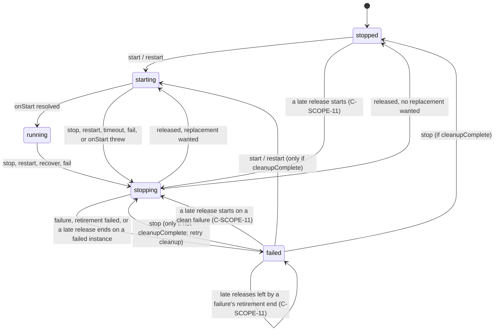

# scopelet

> Stop wrestling with boolean flags and dangling timers — **scopelet** brings structured concurrency and transactional lifecycle management to JavaScript and TypeScript services.

[](https://www.npmjs.com/package/scopelet)
[](LICENSE)
[](https://wintertc.org/)

## The 30-Second Elevator Pitch

Every backend and frontend engineer has fought this bug: a network socket drops, a background reconnect loop starts, listeners accumulate, and when you call `stop()`, a stray timer still wakes up in the background — or a delayed callback from a dead connection fires late and corrupts your new one.

We usually patch this with boolean flags (`isStarting`, `isRunning`). But **boolean flags do not manage ownership, cannot cancel in-flight async operations, and cannot roll back partially acquired resources when startup fails halfway through.**

**Enter Scopelet (The Aha Moment):**
Think of `scopelet` as a desired-state reconciler combined with transactional resource scoping for Node.js, Deno, Bun, and modern browsers:

- **Declarative Intent**: Callers state intent (`start()`, `stop()`, `restart()`). Scopelet ensures operations are idempotent and race-free.
- **Generational Fencing**: Every run is an isolated generation ($G_1, G_2, \dots$) with its own immutable `LifecycleScope`. When a run retires, its scope is permanently sealed — late callbacks from dead connections are fenced out and cannot touch your app.
- **Transactional Ownership Ledger**: Every socket, ping loop, listener, and child lifecycle registered via `scope.acquire()`, `scope.spawn()`, or `scope.start()` is tracked and **guaranteed to unwind in strict reverse order (LIFO)** upon retirement.
- **Cooperative Cancellation**: Built on native Web Platform standards (`AbortSignal`, `AsyncDisposable`). No lingering timers, no zombie listeners, and zero runtime dependencies.

```sh
npm install scopelet
```

```ts
import { AsyncLifecycle, createLifecycle } from 'scopelet'
```

---

## Table of Contents

- [The 30-Second Elevator Pitch](#the-30-second-elevator-pitch)
- [Overview](#overview)
- [The Problem: Why State Flags Fail](#the-problem-why-state-flags-fail)
- [Design Patterns and Core Mechanisms](#design-patterns-and-core-mechanisms)
  - [1. Declarative Intent vs. Single Reconciler Engine](#1-declarative-intent-vs-single-reconciler-engine)
  - [2. Generational Scoping and Fencing Tokens](#2-generational-scoping-and-fencing-tokens)
  - [3. Scoped Ownership Ledger and Deterministic LIFO Teardown](#3-scoped-ownership-ledger-and-deterministic-lifo-teardown)
  - [4. Cooperative Cancellation via AbortSignal](#4-cooperative-cancellation-via-abortsignal)
  - [5. Supervision and Automatic Resilient Recovery](#5-supervision-and-automatic-resilient-recovery)
  - [6. Hierarchical Structured Concurrency (Parent-Child Trees)](#6-hierarchical-structured-concurrency-parent-child-trees)
- [Installation and Runtime Support](#installation-and-runtime-support)
- [Quick Start](#quick-start)
  - [Pattern A: Inheritance (`AsyncLifecycle`)](#pattern-a-inheritance-asynclifecycle)
  - [Pattern B: Composition (`createLifecycle`)](#pattern-b-composition-createlifecycle)
- [Real-World Case Studies (Wechaty Monorepo)](#real-world-case-studies-wechaty-monorepo)
  - [Case Study 1: Resilient WebSocket Client (`Io`)](#case-study-1-resilient-websocket-client-io)
  - [Case Study 2: Service Provider with Conditions and In-Flight Operations (`Puppet`)](#case-study-2-service-provider-with-conditions-and-in-flight-operations-puppet)
  - [Case Study 3: Bot Supervisor with Owned Children (`Wechaty`)](#case-study-3-bot-supervisor-with-owned-children-wechaty)
- [API Reference](#api-reference)
  - [Caller API (`Lifecycle`)](#caller-api-lifecycle)
  - [Implementer Scope API (`LifecycleScope`)](#implementer-scope-api-lifecyclescope)
  - [Companions (`listen`, `operation`, `watchdog`)](#companions-listen-operation-watchdog)
  - [Error Hierarchy](#error-hierarchy)
- [State Machine and Transitions](#state-machine-and-transitions)
- [Formal Specification and Contract](#formal-specification-and-contract)
  - [State Contract (C-STATE)](#state-contract-c-state)
  - [Command Contract (C-CMD)](#command-contract-c-cmd)
  - [Scope Contract (C-SCOPE)](#scope-contract-c-scope)
  - [Retirement Contract (C-RET)](#retirement-contract-c-ret)
  - [Deadline Contract (C-TIME)](#deadline-contract-c-time)
  - [Recovery Contract (C-REC)](#recovery-contract-c-rec)
  - [Child Contract (C-CHILD)](#child-contract-c-child)
  - [Condition Contract (C-COND)](#condition-contract-c-cond)
  - [Observer and Diagnostics Contract (C-OBS)](#observer-and-diagnostics-contract-c-obs)
  - [Entry Points Contract (C-SHELL)](#entry-points-contract-c-shell)
  - [Companions Contract (C-COMP)](#companions-contract-c-comp)
- [Decision Log](#decision-log)
- [Internal Architecture](#internal-architecture)
- [Author and Credits](#author-and-credits)
- [License](#license)

---

## Overview

In complex event-driven applications, background services, network gateways, and bot frameworks, managing startup, graceful shutdown, reconnections, and crashes is notoriously error-prone. Traditional solutions rely on boolean status flags (e.g. `isStarted`, `this.state = 'active'`), mutable timers, and uncoordinated callbacks.

`scopelet` solves this by introducing **Structured Concurrency with Desired-State Reconciliation and Scoped Ownership**:

- **Zero runtime dependencies**: Pure ESM TypeScript, built exclusively on standard Web APIs (`AbortController`, `AbortSignal`, `EventTarget`, `CustomEvent`, `Symbol.asyncDispose`).
- **Universal compatibility**: Fully aligned with WinterTC standards. Runs seamlessly on Node.js (>= 26), Deno, Bun, and modern browsers.
- **Idempotent and race-free**: Callers state intent (`start()`, `stop()`, `restart()`); a single serialized reconciler deterministically drives transitions.
- **Leak-free by design**: Resources, background ping tasks, event listeners, and child lifecycles are registered into a transactional ledger that is guaranteed to unwind in reverse order upon retirement.

---

## The Problem: Why State Flags Fail

In earlier architectures (such as Wechaty's historical `state-switch`), services relied on observable indicators:

```ts
// The legacy pattern: a boolean state indicator
if (this.state.active()) {
  return
}
this.state.active('pending')
await this.init()
this.state.active(true)
```

While state indicators tell observers what state an object is in, they provide **no asynchronous orchestration guarantees**:

1. **Zombie Timers and Background Loops**:
   If a WebSocket connection dropped, an ad-hoc reconnection timer was scheduled. If the user called `stop()`, the timer frequently remained armed in the event loop, causing background connections to fire after shutdown completed. Calling `start()` while a timer lingered threw unrecoverable errors.
2. **Listener Leaks (Zombie Listeners)**:
   Every reconnection attempt re-registered listeners on event emitters or event targets. Without deterministic unhooking, listeners accumulated indefinitely (`MaxListenersExceededWarning`), causing duplicate event processing and massive memory leaks.
3. **Ghost Callbacks and Generational Clashing (ABA Races)**:
   If socket A was closing while socket B was starting, delayed `close` or `error` events from socket A could fire late in the next microtask and tear down or corrupt socket B.
4. **No Cooperative Cancellation**:
   `stop()` had no standard mechanism to tell an ongoing backoff delay, TLS handshake, or I/O operation to cancel immediately, leading to shutdown timeouts and hung CI processes.
5. **Partial Initialization Leaks**:
   If step 4 of a 5-step startup sequence failed, resources acquired during steps 1 through 3 were abandoned without cleanup.
6. **Deadlocks in `reset()` and `restart()`**:
   Naively chaining `await this.stop(); await this.start();` caused deadlocks when operations overlapped or when cleanup hung waiting for an unresponsive remote peer.

---

## Design Patterns and Core Mechanisms

`scopelet` addresses these fundamental failure modes with six architectural pillars:

### 1. Declarative Intent vs. Single Reconciler Engine

Callers declare **intent** (`start()`, `stop()`, `restart()`), but never mutate state directly. A single serialized reconciler engine drives deterministic transitions:



- **Idempotence**: Calling `start()` while already `running` resolves immediately and does not duplicate work.
- **Supersession**: Calling `stop()` while `starting` immediately supersedes and cancels the pending start.
- **Single Flight**: Concurrent `restart()` calls collapse into a single replacement cycle.

### 2. Generational Scoping and Fencing Tokens

Every start attempt increments a monotonic generation counter ($G_1, G_2, \dots$). Each generation receives its own private, frozen `LifecycleScope`:

- The scope exposes `scope.generation` and `scope.signal`.
- When a generation starts retiring, its scope is permanently **sealed**.
- A callback, event listener, or network frame from an older generation holding a sealed scope is **fenced out**; attempts to acquire resources or mutate state throw `LifecycleSupersededError` or resolve as superseded. This completely eliminates ABA race conditions.

### 3. Scoped Ownership Ledger and Deterministic LIFO Teardown

Inside `onStart(scope)`, any resource, child, or task acquired is registered into that generation's ledger:

```ts
// Resource acquisition
const ws = await scope.acquire(
  async signal => openWebSocket(url, signal),
  async ws => closeWebSocket(ws),
)

// Spawning background tasks
scope.spawn(async signal => {
  while (!signal.aborted) {
    await delay(10_000, signal)
    ws.ping()
  }
})

// Deferring cleanups
scope.defer(() => emitter.off('event', handler))
```

When retirement begins, teardown executes in an ironclad, deterministic sequence (**C-RET-01**):

1. **Seal** the scope against new acquisitions.
2. Run **`onStop(stop)`** (only if the generation reached `running`).
3. **Abort** `scope.signal`.
4. Run all registered **interrupt** handlers synchronously.
5. Wait for **`onStart`** to settle.
6. **Join** all spawned background tasks.
7. **Release** all resources, deferred cleanups, and child lifecycles in reverse (**LIFO**) order.
8. **Commit** the final state snapshot (`stopped` or `failed`).

If startup fails halfway through, the ledger automatically unwinds what was already acquired, guaranteeing transactional rollback.

### 4. Cooperative Cancellation via AbortSignal

`scopelet` embraces the standard Web Platform `AbortSignal`. Every async wait, backoff pause, and spawned task receives an `AbortSignal`:

- `delay(ms, scope.signal)` wakes up and cancels immediately when `stop()` is called.
- No timers or pending promises linger in the runtime event loop.

### 5. Supervision and Automatic Resilient Recovery

When an underlying resource drops unexpectedly (e.g. a WebSocket closes or a connection drops), the implementer calls:

```ts
scope.recover(new Error('Connection lost'))
```

If accepted by the reconciler, the engine transitions:
$$\text{running} \longrightarrow \text{stopping} \longrightarrow \text{starting} \ (G+1)$$

The instance recovers automatically without ever exposing spurious `stopped` or `failed` states to callers. If a user calls `stop()` while recovery is in progress, the recovery is cleanly superseded and the service stops.

### 6. Hierarchical Structured Concurrency (Parent-Child Trees)

Lifecycles compose hierarchically:

```ts
protected override async onStart (scope: LifecycleScope): Promise<void> {
  // Start and claim ownership of a child lifecycle
  await scope.start(this.childService)
}
```

- **Cross-Realm Protection**: Child ownership is tracked across multiple installed versions using a shared realm registry on `globalThis[Symbol.for('scopelet.owned-children')]`.
- **Hierarchical Teardown**: Stopping the parent automatically stops all owned children in reverse order.
- **Failure Escalation**: If an owned child crashes unprompted, the failure escalates to the parent with `LifecycleChildFailureError`.

---

## Installation and Runtime Support

Install via npm:

```sh
npm install scopelet
```

### Runtime Support

- **Node.js**: Version 26 or newer (Native ESM, `AbortSignal`, `Symbol.asyncDispose`).
- **Deno**: Supported natively without flags.
- **Bun**: Supported natively.
- **Modern Browsers**: Fully compatible with Chromium, Firefox, WebKit, and Edge via bundlers (Vite, Rollup, Webpack, esbuild) or native browser ESM.
- **Dependencies**: **0 runtime dependencies**.

---

## Quick Start

`scopelet` offers two entry points sharing the exact same underlying engine:

- **`AsyncLifecycle` (Inheritance)**: Ideal when your class has no other base class.
- **`createLifecycle` (Composition)**: Ideal when your class already extends `EventEmitter`, `EventTarget`, or wraps an external client.

### Pattern A: Inheritance (`AsyncLifecycle`)

```ts
import { AsyncLifecycle, type LifecycleScope, type LifecycleStop } from 'scopelet'

export class WorkerClient extends AsyncLifecycle {

  private socket?: WebSocket

  constructor () {
    super({
      name: 'WorkerClient',
      startTimeoutMs: 10_000,
      stopTimeoutMs: 5_000,
    })
  }

  protected override async onStart (scope: LifecycleScope): Promise<void> {
    // 1. Acquire resource with automatic cleanup
    this.socket = await scope.acquire(
      async signal => {
        const ws = new WebSocket('wss://api.example.com')
        await waitForOpen(ws, signal)
        return ws
      },
      async ws => {
        ws.close()
      },
    )

    // 2. Spawn a background loop tied to the generation
    scope.spawn(async signal => {
      while (!signal.aborted) {
        await delay(10_000, signal)
        this.socket?.send('ping')
      }
    })
  }

  protected override async onStop (stop: LifecycleStop): Promise<void> {
    console.log(`Worker stopping due to: ${stop.reason}`)
  }

}

// Usage:
const worker = new WorkerClient()
await worker.start()

// Caller API
console.log(worker.state.kind) // 'running'

// Explicit stop
await worker.stop()

// Or using standard ECMAScript explicit resource management:
{
  await using client = new WorkerClient()
  await client.start()
} // client.stop() automatically called here
```

### Pattern B: Composition (`createLifecycle`)

```ts
import { EventEmitter } from 'node:events'
import {
  createLifecycle,
  type Lifecycle,
  type LifecycleController,
  type LifecycleScope,
  type LifecycleState,
  type LifecycleWaitOptions,
} from 'scopelet'

export class DatabaseService extends EventEmitter implements Lifecycle {

  readonly #lifecycle: LifecycleController

  constructor () {
    super()
    this.#lifecycle = createLifecycle({
      onStart: scope => this.#onStart(scope),
      onStop: stop => this.#onStop(stop),
      onStateChange: (state, prev) => this.emit('stateChange', state, prev),
    }, { name: 'DatabaseService' })
  }

  // Delegate the public Lifecycle contract
  get state () { return this.#lifecycle.state }
  start (options?: LifecycleWaitOptions) { return this.#lifecycle.start(options) }
  stop (options?: LifecycleWaitOptions) { return this.#lifecycle.stop(options) }
  restart (options?: LifecycleWaitOptions) { return this.#lifecycle.restart(options) }
  whenState (predicate: (state: LifecycleState) => boolean, options?: LifecycleWaitOptions) {
    return this.#lifecycle.whenState(predicate, options)
  }
  [Symbol.asyncDispose] () { return this.#lifecycle[Symbol.asyncDispose]() }

  async #onStart (scope: LifecycleScope): Promise<void> {
    // Acquire DB connection
    const db = await scope.acquire(
      () => connectToDatabase(),
      db => db.disconnect(),
    )
  }

  async #onStop (stop: any): Promise<void> {
    // Graceful flushing
  }

}
```

---

## Real-World Case Studies (Wechaty Monorepo)

`scopelet` is the core architectural foundation powering asynchronous operations across the Wechaty monorepo.

### Case Study 1: Resilient WebSocket Client (`Io`)

`Io` connects a Wechaty bot to the cloud or gateway over WebSocket. It demonstrates:

- **Resilient Reconnections**: Reconnecting with backoff in `onStart` when offline.
- **Instance-Level Event Buffer**: Retaining un-sent bot events across disconnects, restarts, and stop/start cycles.
- **Bounded Shutdown**: Sending one final bounded batch in `onStop` without hanging past deadlines.

```ts
export class Io extends AsyncLifecycle {

  protected eventBuffer: IoEvent[] = []
  protected ws?: WebSocket
  #failures = 0
  #reconnecting = false

  protected override async onStart (scope: LifecycleScope): Promise<void> {
    const retry = this.#reconnecting
    this.#reconnecting = false

    // Connect with backoff
    this.ws = await this.connectWithBackoff(scope, retry)

    // Spawn keepalive ping task
    scope.spawn(async signal => {
      while (!signal.aborted) {
        await delay(10_000, signal)
        this.#failures = 0
        if (this.ws?.readyState === WebSocket.OPEN) {
          this.ws.ping()
        }
      }
    })
  }

  private watchSocket (scope: LifecycleScope, ws: WebSocket): void {
    ws.on('close', (code, reason) => {
      this.#failures++
      // Trigger automatic recovery when the remote socket drops
      if (scope.recover(new Error(`WebSocket closed: ${code}`)) === 'accepted') {
        this.#reconnecting = true
      }
    })
  }

  protected override async onStop (stop: LifecycleStop): Promise<void> {
    // Bounded flush: send what is buffered without exceeding stop deadlines
    await this.flushBuffer({ lastBatch: true })
  }

}
```

### Case Study 2: Service Provider with Conditions and In-Flight Operations (`Puppet`)

`Puppet` providers (such as `PuppetMock`, `PuppetService`) represent chat network connectors. They demonstrate:

- **Generation-Bound Conditions (`login`, `ready`)**: Conditions automatically clear when a generation retires, preventing stale readiness reporting.
- **Protected Public Operations (`operation`)**: Guarding RPC calls like `messageSend` so that shutdown waits for active calls, while calls arriving post-retirement reject cleanly.

```ts
export abstract class Puppet extends EventEmitter implements Lifecycle {

  readonly #lifecycle: LifecycleController
  readonly #login: LifecycleCondition
  readonly #ready: LifecycleCondition
  #scope?: LifecycleScope

  constructor () {
    super()
    this.#lifecycle = createLifecycle({
      onStart: scope => this.#start(scope),
      onStop: stop => this.#stop(stop),
    }, { name: 'Puppet' })

    this.#login = this.#lifecycle.condition('login')
    this.#ready = this.#lifecycle.condition('ready')
  }

  async #start (scope: LifecycleScope): Promise<void> {
    await this.onStart()
    this.#scope = scope
    scope.set(this.#ready)
  }

  /** Send message protected by the operation companion */
  async messageSend (conversationId: string, text: string): Promise<string> {
    if (!this.#scope) {
      throw new Error('Puppet not started')
    }
    return operation(this.#scope, async signal => {
      return this.onMessageSend(conversationId, text, signal)
    })
  }

}
```

### Case Study 3: Bot Supervisor with Owned Children (`Wechaty`)

`Wechaty` sits at the top of the hierarchy, supervising both `Puppet` and `Io` as owned children:

```ts
export class Wechaty extends EventEmitter implements Lifecycle {

  readonly #lifecycle: LifecycleController
  readonly puppet: Puppet
  readonly io?: Io

  constructor (options: WechatyOptions) {
    super()
    this.puppet = options.puppet
    this.io = options.io ? new Io(options.io) : undefined

    this.#lifecycle = createLifecycle({
      onStart: scope => this.#onStart(scope),
    }, { name: 'Wechaty' })
  }

  async #onStart (scope: LifecycleScope): Promise<void> {
    // Start Puppet as a managed child
    await scope.start(this.puppet)

    // Optionally start Io as a managed child
    if (this.io) {
      await scope.start(this.io)
    }
  }

  /** Delegates readiness directly to the puppet's condition */
  async ready (): Promise<void> {
    await this.puppet.whenReady()
  }

}
```

Stopping `Wechaty` automatically stops `Io` and `Puppet` in reverse order. If `Puppet` crashes, the failure escalates to `Wechaty`.

---

## API Reference

### Caller API (`Lifecycle`)

The primary interface exposed to consumers:

```ts
interface Lifecycle extends AsyncDisposable {
  /** Frozen snapshot of the current state */
  readonly state: LifecycleState

  /** Request the instance to start; resolves when running commits */
  start (options?: LifecycleWaitOptions): Promise<void>

  /** Request the instance to stop; resolves when all resources are released */
  stop (options?: LifecycleWaitOptions): Promise<void>

  /** Retire current run and start a new generation; resolves when replacement is running */
  restart (options?: LifecycleWaitOptions): Promise<void>

  /** Await until state satisfies a given predicate */
  whenState (
    predicate: (state: LifecycleState) => boolean,
    options?: LifecycleWaitOptions,
  ): Promise<LifecycleState>

  /** Standard Async Disposable equivalent to stop() */
  [Symbol.asyncDispose] (): Promise<void>
}
```

### Implementer Scope API (`LifecycleScope`)

Passed into `onStart(scope)` for each generation:

```ts
interface LifecycleScope {
  /** Monotonic run generation number (1, 2, ...) */
  readonly generation: number

  /** AbortSignal triggered when retirement begins */
  readonly signal: AbortSignal

  /** Acquire an external resource with a mandatory release handler */
  acquire<T> (
    create: (signal: AbortSignal) => Promise<T>,
    release: (resource: T) => unknown,
    options?: { interrupt?: (resource: T) => unknown },
  ): Promise<T>

  /** Register an AsyncDisposable or Disposable resource */
  use<T extends AsyncDisposable | Disposable> (resource: T): T

  /** Register a teardown function executed upon retirement */
  defer (cleanup: () => unknown): void

  /** Spawn an asynchronous task joined during retirement */
  spawn (task: (signal: AbortSignal) => Promise<void>): void

  /** Start and claim ownership of a child lifecycle */
  start (child: Lifecycle): Promise<void>

  /** Declare a condition satisfied for this generation */
  set (condition: LifecycleCondition): void

  /** Clear a condition */
  clear (condition: LifecycleCondition): void

  /** Fail this generation immediately */
  fail (error: unknown): void

  /** Request resilient recovery to a new generation */
  recover (reason?: unknown): 'accepted' | 'superseded' | 'failed'
}
```

### Companions (`listen`, `operation`, `watchdog`)

Standalone utility functions built on top of `LifecycleScope`:

#### `listen(scope, target, event, listener)`

Registers an event listener on an `EventEmitter` or `EventTarget` and automatically unhooks it when the generation retires. Prevents memory leaks without manual `off()` calls.

#### `operation(scope, work)`

Runs `work(signal)` as a tracked in-flight operation of the generation. Retirement waits for operations in flight before releasing resources. Calls after retirement reject with `LifecycleSupersededError`.

#### `watchdog(scope, { timeoutMs, onTimeout, clock? })`

Arms a watchdog timer. Must be fed periodically via `.feed()`. If the timer expires, triggers `scope.fail()` or `scope.recover()` with a `LifecycleTimeoutError`.

### Error Hierarchy

All errors extend `LifecycleError` and expose a stable `.code` property:

| Class | `code` | Description |
|---|---|---|
| `LifecycleError` | (base) | Base class for all lifecycle errors |
| `LifecycleSupersededError` | `ERR_LIFECYCLE_SUPERSEDED` | An operation or wait was cancelled because a newer command took precedence |
| `LifecycleTimeoutError` | `ERR_LIFECYCLE_TIMEOUT` | Start deadline, stop deadline, or watchdog timer expired |
| `LifecycleUnsafeStateError` | `ERR_LIFECYCLE_UNSAFE_STATE` | Attempted an operation on a dirty or invalid state |
| `LifecycleChildFailureError` | `ERR_LIFECYCLE_CHILD_FAILURE` | An owned child lifecycle crashed or stopped unexpectedly |
| `LifecycleOverrideError` | `ERR_LIFECYCLE_OVERRIDE` | Subclass attempted to illegally override protected caller API methods |

Check errors safely across multiple package versions using `isLifecycleError`:

```ts
import { isLifecycleError } from 'scopelet'

if (isLifecycleError(err, 'ERR_LIFECYCLE_SUPERSEDED')) {
  // Handle supersession
}
```

---

## State Machine and Transitions

### State Matrix

| Current State | `start()` | `stop()` | `restart()` |
|---|---|---|---|
| `stopped` | Allocates next generation; begins `starting` | Resolves immediately | Behave as `start()` |
| `starting(G)` | Joins pending start attempt | Aborts $G$, supersedes waiters, retires $G$ | Aborts $G$, supersedes waiters, retires $G$, then starts $G+1$ |
| `running(G)` | Resolves immediately (no-op) | Retires $G$ to `stopped` | Retires $G$, then starts $G+1$ |
| `stopping(G)` (no replacement) | Queues $G+1$ to start after $G$ releases | Joins ongoing retirement pass | Queues $G+1$ to start after $G$ releases |
| `stopping(G)` (replacement queued) | Joins queued $G+1$ start | Supersedes queued $G+1$; joins retirement | Joins queued $G+1$ start |
| `failed(G)` (clean) | Allocates next generation | Commits `stopped`, resolves | Behave as `start()` |
| `failed(G)` (dirty) | Rejects with `LifecycleUnsafeStateError` | Retries unreleased cleanup | Rejects with `LifecycleUnsafeStateError` |

---

## Formal Specification and Contract

The following clauses constitute the formal normative contract of `scopelet`. Every test in the test suite verifies one or more of these rule IDs.

### State Contract (C-STATE)

- **C-STATE-01**: `state` is a frozen snapshot. Each transition publishes a new object; a snapshot never changes after it is published.
- **C-STATE-02**: The initial state is `{ kind: 'stopped', generation: 0 }`.
- **C-STATE-03**: Every start attempt allocates the next generation number, whether or not it succeeds. Generation numbers never decrease.
- **C-STATE-04**: Transitions follow the state machine diagram exclusively.
- **C-STATE-05**: `failed` carries `phase` (`'start'`, `'run'`, or `'stop'`), `error`, `cleanupComplete`, and `cleanupError` when cleanup fails.
- **C-STATE-06**: `failed { cleanupComplete: false }` blocks every new generation until a `stop()` finishes cleanup.
- **C-STATE-07**: `stopped` and `failed { cleanupComplete: true }` guarantee that every obligation of every earlier generation was released.

### Command Contract (C-CMD)

- **C-CMD-01**: Commands accept intent synchronously before their first `await`.
- **C-CMD-02**: A caller's abort signal cancels only that caller's wait, never shared work or accepted intent.
- **C-CMD-03**: Equivalent concurrent calls share one outcome. Concurrent `restart()` calls share one replacement.
- **C-CMD-04**: `start()` while `running` resolves immediately and starts nothing.
- **C-CMD-05**: `start()` while `starting` joins that attempt and never aborts it.
- **C-CMD-06**: `start()` during retirement queues one replacement that starts only after retirement completes. Two generations never overlap.
- **C-CMD-07**: `stop()` supersedes every pending start, restart, and recovery with `LifecycleSupersededError`.
- **C-CMD-08**: `stop()` resolves when the captured generation is released, even if a newer `start()` is queued behind it.
- **C-CMD-09**: `stop()` while `stopped` resolves at once. On a clean `failed` state it commits `stopped`, then resolves.
- **C-CMD-10**: `stop()` on dirty `failed` retries unreleased obligations.
- **C-CMD-11**: `restart()` retires current generation and resolves only when a replacement commits `running`.
- **C-CMD-12**: `restart()` from `stopped` or clean `failed` behaves like `start()`.
- **C-CMD-13**: `start()` and `restart()` on dirty `failed` reject with `LifecycleUnsafeStateError`.
- **C-CMD-14**: A failed attempt ends; nothing retries automatically without explicit command or `scope.recover()`.
- **C-CMD-15**: `[Symbol.asyncDispose]()` is identical to `stop()`.
- **C-CMD-16**: `whenState(predicate)` resolves with the first snapshot matching `predicate`.
- **C-CMD-17**: A failed start rejects callers as soon as failure is decided, without waiting for cleanup to finish.

### Scope Contract (C-SCOPE)

- **C-SCOPE-01**: Each generation has one scope, frozen. Its `generation` and `signal` belong to that generation only.
- **C-SCOPE-02**: When retirement begins, the scope is **sealed**. Subsequent acquisitions or spawns throw or reject with the retirement reason.
- **C-SCOPE-03**: Obligations are released in the order of **C-RET-01**.
- **C-SCOPE-04**: `acquire` registers the release before `create` runs.
- **C-SCOPE-05**: `acquire` interrupts run synchronously in retirement step 4.
- **C-SCOPE-06**: `use` supports `Symbol.asyncDispose` and `Symbol.dispose`.
- **C-SCOPE-07**: A spawned task receives `scope.signal`. A rejection with `signal.reason` counts as cooperative cancellation; other rejections fail the generation.
- **C-SCOPE-08**: Registering the same cleanup function twice creates two obligations.
- **C-SCOPE-09**: A release that fails remains owned and is retried by subsequent `stop()` calls.
- **C-SCOPE-10**: Cleanups and releases returning promise-likes are awaited; exceptions are captured as cleanup errors and never crash the process.
- **C-SCOPE-11**: Late releases registered on a retiring scope remain obligations of the instance until settled.

### Retirement Contract (C-RET)

- **C-RET-01**: Retirement executes in strict order:
  1. Seal scope.
  2. Invoke `onStop` (only if generation reached `running`).
  3. Abort `scope.signal`.
  4. Run interrupts synchronously.
  5. Await `onStart` settlement.
  6. Join spawned tasks.
  7. Release resources, deferred cleanups, and stop children (newest first).
  8. Commit outcome (`stopped`, `starting`, or `failed`).
- **C-RET-02**: `onStop` runs at most once per generation.
- **C-RET-03**: A generation failing before `running` skips `onStop` and rolls back via its ledger.
- **C-RET-04**: Multiple cleanup errors are aggregated into `AggregateError`.
- **C-RET-05**: Concurrent `stop()` calls share one retirement pass.
- **C-RET-06**: A replacement starts only after the prior generation has fully released.
- **C-RET-07**: `onStart` is never called for a generation that was cancelled before startup began.

### Deadline Contract (C-TIME)

- **C-TIME-01**: `startTimeoutMs` and `stopTimeoutMs` must be finite numbers > 0.
- **C-TIME-02**: The start deadline runs from `starting` until `running` commits.
- **C-TIME-03**: The stop deadline covers the entire retirement pass.
- **C-TIME-04**: Deadlines evaluate against the configured `LifecycleClock`.
- **C-TIME-05**: A deadline is judged by the clock when an outcome commits.

### Recovery Contract (C-REC)

- **C-REC-01**: `scope.fail(error)` retires generation without replacement to `failed`.
- **C-REC-02**: Accepted `scope.recover(reason)` retires current generation and starts replacement without passing through `stopped` or `failed`.
- **C-REC-03**: `scope.recover()` returns synchronously (`'accepted' | 'superseded' | 'failed'`).
- **C-REC-04**: Recovery authority is re-validated after release before starting replacement.
- **C-REC-05**: Tasks calling `recover()` are joined during retirement.
- **C-REC-06**: The engine contains no hardcoded retry policies; retry policies reside in implementer hooks.

### Child Contract (C-CHILD)

- **C-CHILD-01**: `scope.start(child)` requires `child` to be `stopped` or cleanly `failed`.
- **C-CHILD-02**: Ownership is recorded in `globalThis[Symbol.for('scopelet.owned-children')]` before starting.
- **C-CHILD-03**: `scope.start(child)` aborts if parent retires while child is starting.
- **C-CHILD-04**: Children stop in retirement step 7, newest first.
- **C-CHILD-05**: If an owned child crashes unprompted, the parent fails with `LifecycleChildFailureError`.
- **C-CHILD-06**: If child start fails, `scope.start()` rejects with that error.
- **C-CHILD-07**: A child restarting during parent stop leaves cleanup debt on the parent.

### Condition Contract (C-COND)

- **C-COND-01**: Conditions are declared per instance by name.
- **C-COND-02**: A condition wait binds to the current or next generation.
- **C-COND-03**: A wait resolves when the bound generation sets the condition.
- **C-COND-04**: A wait rejects with `LifecycleSupersededError` if the bound generation retires first.
- **C-COND-05**: Results never leak across generations; conditions reset on new generations.
- **C-COND-06**: `isSet` is `true` only while current live generation has set it.

### Observer and Diagnostics Contract (C-OBS)

- **C-OBS-01**: Commits follow: freeze snapshot $\to$ settle waiters $\to$ publish diagnostics $\to$ call `onStateChange`.
- **C-OBS-02**: Exceptions in observers or diagnostic subscribers never alter engine outcomes.
- **C-OBS-03**: Observers may call commands safely.
- **C-OBS-04**: Diagnostic events publish to `node:diagnostics_channel` channel `scopelet.state`.

### Entry Points Contract (C-SHELL)

- **C-SHELL-01**: `createLifecycle` and `AsyncLifecycle` share the same engine.
- **C-SHELL-02**: Caller API methods cannot be overridden by subclasses.
- **C-SHELL-03**: `createLifecycle` validates hook signatures.
- **C-SHELL-04**: The `name` option is a diagnostic label and must not contain secrets.

### Companions Contract (C-COMP)

- **C-COMP-01**: `listen` safely registers event listeners and unhooks them upon retirement.
- **C-COMP-02**: `watchdog` arms an automatic heartbeat timeout trigger.
- **C-COMP-03**: `operation` wraps in-flight public work, awaiting completion on retirement.

---

## Decision Log

Key architectural decisions recorded during design convergence:

| ID | Decision |
|---|---|
| **D1** | Single reconciler engine with two entry points (`AsyncLifecycle` and `createLifecycle`). |
| **D2** | Caller API: `state`, `start`, `stop`, `restart`, `whenState`, `[Symbol.asyncDispose]`. |
| **D3** | `state` is a frozen discriminated union with explicit `cleanupComplete` truth. |
| **D4** | `Symbol.asyncDispose` maps directly to `stop()`. |
| **D5** | Readiness modeled via named generation-bound conditions (`LifecycleCondition`). |
| **D6** | `acquire` records ownership before resource creation begins. |
| **D7** | Generic mechanism lives in the kernel; retry and backoff policies belong in user hooks. |
| **D8** | `onStop` is invoked only if the generation successfully reached `running`. |
| **D9** | Teardown joins spawned tasks before releasing underlying resources. |
| **D13** | Stable error codes (`ERR_LIFECYCLE_*`) with structural `isLifecycleError()` checking. |
| **D20** | Zero runtime dependencies; extracted as standalone package `scopelet`. |
| **D21** | Child ownership registry shared per JS realm on `globalThis[Symbol.for('scopelet.owned-children')]`. |
| **D24** | In-flight work guarded via `operation()` companion; legacy shims live in integration layer. |
| **D42** | `scope.recover()` returns decision synchronously to prevent task deadlocks. |
| **D43** | Diagnostics channel dynamically looked up; gracefully no-ops in browser environments. |

---

## Internal Architecture

Source code organization under `packages/scopelet/src/`:

```text
src/
├── types.ts              # Public TypeScript interfaces and contracts
├── errors.ts             # LifecycleError classes and error codes
├── engine.ts             # Reconciler, state machine, and commit pipeline
├── generation.ts         # Generation scope, AbortController, and realm child registry
├── ledger.ts             # Transactional resource obligations and LIFO release queue
├── condition.ts          # Generation-bound conditions
├── clock.ts              # Timer abstraction and deadline evaluation
├── diagnostics.ts        # diagnostics_channel publisher
├── create-lifecycle.ts   # Composition entry point
├── async-lifecycle.ts    # Inheritance entry point
├── companions/
│   ├── listen.ts         # Memory-leak-free listener companion
│   ├── operation.ts      # In-flight task tracking companion
│   └── watchdog.ts       # Heartbeat supervisor companion
└── mod.ts                # Main package export root
```

---

## Author and Credits

**Scopelet** is designed and created by:

- **Huan LI (李卓桓)**
  - GitHub: [@huan](https://github.com/huan)
  - Personal Website: <https://huan.dev>
  - Creator of Wechaty and open-source distributed systems contributor

Special thanks to the **Wechaty Contributors** and the architectural contributions recorded in the Wechaty 2.0 AsyncLifecycle design RFCs ([#2905](https://github.com/wechaty/wechaty/issues/2905), [#2911](https://github.com/wechaty/wechaty/issues/2911), [#2968](https://github.com/wechaty/wechaty/issues/2968)).

---

## License

Apache License 2.0

Copyright (c) 2016–present Huan LI (李卓桓) <huan@chatie.io> and Wechaty Contributors.

Licensed under the Apache License, Version 2.0 (the "License");
you may not use this file except in compliance with the License.
You may obtain a copy of the License at <http://www.apache.org/licenses/LICENSE-2.0>.

Unless required by applicable law or agreed to in writing, software
distributed under the License is distributed on an "AS IS" BASIS,
WITHOUT WARRANTIES OR CONDITIONS OF ANY KIND, either express or implied.
See the License for the specific language governing permissions and
limitations under the License.
