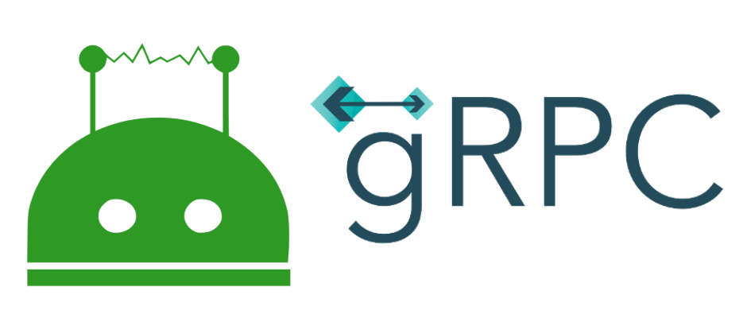

<!-- markdownlint-disable MD033 MD041 -->

<div align="center">

<br />
<h1>Wechaty gRPC</h1>
<p>
gRPC Service & Protocol Buffers for Wechaty Puppet
</p>
<a href="https://github.com/wechaty/grpc/issues
"></a>
<a href="https://github.com/wechaty/grpc/network/members"></a>
<a href="https://github.com/wechaty/grpc/stargazers"></a>
<a href="https://github.com/wechaty/grpc/blob/master/LICENSE"></a>
<a href="https://github.com/Chatie/tsconfig/issues/16"></a>
</div>

<div align="center">

[](https://github.com/wechaty/wechaty/actions/workflows/node.js.yml)

[](https://www.npmjs.com/package/wechaty-grpc)
[](https://pypi.org/project/chatie-grpc/)
[](https://mvnrepository.com/artifact/io.github.wechaty/grpc)
[](https://packagist.org/packages/wechaty/php-grpc)
[](https://nodejs.org/)
[](https://www.python.org/downloads/release/python-370/)
[](https://pkg.go.dev/github.com/wechaty/grpc/go/wechaty)

</div>

<details open="open">
<summary>Table of Contents</summary>
<ol>
<li>
<a href="#About">About</a>
</li>
<li>
<a href="#Usage">Usage</a>
<ul>
<li><a href="#Nodejs">Node.js</a></li>
<li><a href="#Python">Python</a></li>
<li><a href="#Go">Go</a></li>
<li><a href="#Java">Java</a></li>
<li><a href="#PHP">PHP</a></li>
<li><a href="#CSharp">CSharp</a></li>
</ul>
</li>
<li>
<a href="#Development">Development</a>
<ul>
<li><a href="#Debug">Debug</a></li>
<li><a href="#Build">Build</a></li>
<li><a href="#Generate-Stubs">Generate Stubs</a></li>
</ul>
</li>
<li><a href="#OpenAPI">OpenAPI</a></li>
<li><a href="#gRPC-Web">gRPC Web</a></li>
<li><a href="#Resources">Resources</a></li>
<li><a href="#Contributing">Contributing</a></li>
<li><a href="#Maintainer">Maintainer</a></li>
<li><a href="#Copyright--License">Copyright & License</a></li>
</ol>

## In the Wechaty monorepo

This package lives in the [Wechaty monorepo](https://github.com/wechaty/wechaty) at
`packages/wechaty-grpc`, where it moved from `wechaty/grpc` in 2.0
([wechaty/wechaty#3054](https://github.com/wechaty/wechaty/issues/3054)).

- The Node.js package (`wechaty-grpc` on npm) is built, tested and published from here. It needs
  Node.js 26 or newer and is ESM only.
- The other-language packages in `polyglot/` (C#, Go, Java, PHP, Python) and the OpenAPI document
  in `openapi/` are kept but not built or published until the protocol freezes at 2.0.0
  ([wechaty/wechaty#3053](https://github.com/wechaty/wechaty/issues/3053)). Their old CI workflows
  are in the history of `wechaty/grpc`.

## About

gRPC is a modern open-source high-performance Remote Procedure Call (RPC) framework that can run in any environment. It can efficiently connect services in and across data centers with pluggable support for load balancing, tracing, health checking, and authentication. It is also applicable in the last mile of distributed computing to connect devices, mobile applications, and browsers to backend services.

## Usage

### Node.js

[wechaty-grpc@NPM](https://www.npmjs.com/package/wechaty-grpc)

**Docs:**
  
- <https://paka.dev/npm/wechaty-grpc>
- <https://wechaty.github.io/grpc/>

**Maintainer:**

- [@huan](https://github.com/huan) - Huan Li <huan@chatie.io>

### Python

[chatie-grpc@PyPI](https://pypi.org/project/chatie-grpc)

**Maintainer:**

- [@wj-Mcat](https://github.com/wj-Mcat) - Jingjing WU (吴京京)

### Go

[github.com/wechaty/go-grpc](https://github.com/wechaty/go-grpc)

**Maintainer:**

- [@dchaofei](https://github.com/dchaofei) - Chaofei DING (丁超飞)

### Java

[https://mvnrepository.com/artifact/io.github.wechaty/grpc](https://mvnrepository.com/artifact/io.github.wechaty/grpc)

**Maven:**

```xml
<dependency>
    <groupId>io.github.wechaty</groupId>
    <version>0.11.25</version>
    <artifactId>grpc</artifactId>
</dependency>
```

**Gradle:**

```groovy
compile 'io.github.wechaty:grpc:0.11.25'
```

**Maintainer:**

- [@diaozxin007](https://github.com/diaozxin007) - Zhengxin DIAO (刁政欣)

### PHP

[github.com/wechaty/php-grpc](https://github.com/wechaty/php-grpc)

**Maintainer:**

- [@zhangchunsheng](https://github.com/zhangchunsheng) - Chunsheng ZHANG (张春生)

### CSharp

[Wechaty.Grpc @ Nuget](https://www.nuget.org/packages/Wechaty.Grpc)

**Maintainer:**

- [@Darren](https://github.com/jesn) - Darren (郑波)

## Development

### Debug

- [GUI Client for GRPC Services](https://github.com/uw-labs/bloomrpc) - BloomRPC aims to give the simplest and efficient developer experience for exploring and querying your GRPC services. (Inspired by Postman and GraphQL Playground)
- [A gRPC CLI interface for easy testing against gRPC servers with Node.js REPL](https://github.com/njpatel/grpcc)

```shell
grpcc --proto ./service/myservice.proto --address 127.0.0.1:3466
```

### Build

Install once at the monorepo root. The `grpc-tools` install script downloads `protoc`; the root
`package.json` allows it in `allowScripts`.

```shell
npm ci
```

### Generate Stubs

```shell
npm run generate --workspace wechaty-grpc
```

`scripts/generate-stub.ts` writes everything into `out/` (gitignored) using only npm packages, with
`proto/` and the pinned files in `third-party/` (see its README) as inputs, so it works offline:

1. JavaScript messages and grpc-js service stubs: `protoc` and the gRPC Node plugin from
   [grpc-tools](https://www.npmjs.com/package/grpc-tools).
2. Typings for the service stubs:
   [grpc_tools_node_protoc_ts](https://github.com/agreatfool/grpc_tools_node_protoc_ts).
3. Typings for the messages: [ts-protoc-gen](https://github.com/improbable-eng/ts-protoc-gen), which
   declares each enum with a `XxxMap` interface, as 1.x consumers expect.

The lint, test, coverage and build scripts run `generate` first. grpc-web stubs and the OpenAPI
document are no longer generated.

### Naming conventions & Style Guide

1. [Google Cloud APIs - Naming conventions](https://cloud.google.com/apis/design/naming_convention)
1. [Protocol Buffers - Developer Guide - Style Guide](https://developers.google.com/protocol-buffers/docs/style)

## OpenAPI

Learn more about the RESTful API service for Wechaty from [Wechaty OpenAPI](https://github.com/wechaty/openapi).

## gRPC Web

- [gRPC-Web ReactJS client, Golang Server](https://github.com/longfellowone/grpcwebtest)

## RESOURCES

### Documentation

- [Protocol Buffers Language Guide (proto3)](https://developers.google.com/protocol-buffers/docs/proto3)
- [Google Protocol Buffers Style Guide](https://developers.google.com/protocol-buffers/docs/style)
- [Protocol Buffers for TypeScript with Decorators](https://github.com/protobufjs/protobuf.js#using-decorators)
- [Troubleshooting gRPC](https://github.com/grpc/grpc/blob/master/TROUBLESHOOTING.md)
- [gRPC environment variables](https://github.com/grpc/grpc/blob/master/doc/environment_variables.md)
- [How to Interact With and Debug a gRPC Server](https://medium.com/@EdgePress/how-to-interact-with-and-debug-a-grpc-server-c4bc30ddeb0b)

### Links

- [探讨gRPC的Node技术生态及实现工具](https://xenojoshua.com/2018/02/grpc-node-ecosystem/)
- [gRPC Basics - Node.js](https://grpc.io/docs/tutorials/basic/node.html)
- [Building a gRPC service with Node.js](https://codelabs.developers.google.com/codelabs/cloud-grpc/)
- [gRPC in 3 minutes (Node.js)](https://github.com/grpc/grpc/tree/master/examples/node)
- [Listen gRPC and HTTP requests on the same port](https://medium.com/@drgarcia1986/listen-grpc-and-http-requests-on-the-same-port-263c40cb45ff)
- [gRPC to JSON proxy generator following the gRPC HTTP spec](https://github.com/grpc-ecosystem/grpc-gateway)
- [如何在 Node.js 中更优雅地使用 gRPC：grpc-helper](https://github.com/xizhibei/blog/issues/86)
- [Comparing OpenAPI With gRPC](https://dzone.com/articles/comparing-openapi-with-grpc)

#### Protocol Buffer

Thanks to the ecosystem of gRPC, we can generate OpenAPI Specification from our gRPC proto definitions automatically.

We are using [gRPC to JSON proxy generator following the gRPC HTTP spec](https://github.com/grpc-ecosystem/grpc-gateway) as the OpenAPI Specification generator ([protoc-gen-openapiv2](https://github.com/grpc-ecosystem/grpc-gateway/tree/master/protoc-gen-openapiv2)), and using [Like grpc-gateway, but written in node and dynamic](https://github.com/konsumer/grpc-dynamic-gateway) project to serve an HTTP RESTful API to gRPC proxy.

<div align="center"><a link="https://github.com/wechaty/openapi"><a></div>

> Image credit: [gRPC Gateway](https://grpc-ecosystem.github.io/grpc-gateway/)

Learn more about the RESTful API service for Wechaty from [Wechaty OpenAPI](https://github.com/wechaty/openapi).

See also:

- [AIP-4222 - Routing headers](https://google.aip.dev/client-libraries/4222)
- [gRPC-Gateway Official Website](https://grpc-ecosystem.github.io/grpc-gateway/)

## Resources

Check out [RESOURCES.md](RESOURCES.md) file for learning resources.

## Guidelines

- [Google Protocol Buffers Style Guide](https://developers.google.com/protocol-buffers/docs/style)
- [Google Cloud API Naming Conventions](https://cloud.google.com/apis/design/naming_convention)
- [Google Cloud Cloud API Design Guide](https://cloud.google.com/apis/design/)

## Changelog

### v2.0 (unreleased)

1. Moved into the Wechaty monorepo ([wechaty/wechaty#3054](https://github.com/wechaty/wechaty/issues/3054))
1. ESM only, Node.js 26; Node.js runs the TypeScript sources directly, and only packaging compiles to `dist/`
1. Code generation needs only npm packages and the pinned `third-party/` protos; no system `protoc`,
   Go or network access
1. Breaking: the `openApi` export is removed, and grpc-web stubs are no longer generated
1. Tests use `node:test`, run under Node.js and Deno, and close their clients and bind free ports

### master v1.0 (Mar 14, 2022)

1. v1.0 release
1. add `post` event

### v0.33 (Oct 18, 2021)

- ~~[ ] Rename `ENUM` from `CONTACT_GENDER_MALE` to `MALE` ([#110](https://github.com/wechaty/grpc/issues/110))~~
- [ ] Fix typos

### v0.27

1. ES Modules support
1. Export generated protocol buffers class as `puppet`

### v0.20 (Feb 21, 2021)

1. Rename NPM module name from `@chatie/grpc` to `wechaty-grpc`
1. Add OpenAPI annotations & generators for supporting <https://github.com/wechaty/openapi>
1. Code clean.

### v0.18 (Oct 15, 2020)

- Add new `MessageFileStream` and `MessageImageStream` to replace the `MessageFile` and `MessageImage` method to avoid blocking nodejs event loop when sending large files ([#88](https://github.com/wechaty/grpc/pull/88)) by [@windmemory](https://github.com/windmemory)
- Add new `MessageSendFileStream` to replace the `MessageSendFile` method to avoid blocking nodejs event loop when sending large files ([#89](https://github.com/wechaty/grpc/pull/89)) by [@windmemory](https://github.com/windmemory)

### v0.17 (Aug 5, 2020)

- Add PHH Support ([#76](https://github.com/wechaty/grpc/pull/76) [#78](https://github.com/wechaty/grpc/pull/78)) by [@zhangchunsheng](https://github.com/zhangchunsheng)
- Publish PHP Module at <https://github.com/wechaty/php-grpc>

### v0.13 (Apr 19, 2020)

- Add Java Support ([#52](https://github.com/wechaty/grpc/issues/52) [#53](https://github.com/wechaty/grpc/issues/53) by [@diaozxin007](https://github.com/diaozxin007))
- Publish Java Module at [Open Source Project Repository HostingOSSRH-56843 - Release the Chatie/grpc Java Client](https://issues.sonatype.org/browse/OSSRH-56843)

### v0.11 (Apr 10, 2020)

- Add Go Support ([#50](https://github.com/wechaty/grpc/issues/50) by [@dchaofei](https://github.com/dchaofei))
- Publish Go Module at <github.com/wechaty/go-grpc>

Contributions are what make the open-source community such an amazing place to learn, inspire, and create. Any contributions you make are **greatly appreciated**.

1. Fork the Project
2. Create your Feature Branch (`git checkout -b feature/AmazingFeature`)
3. Commit your Changes (`git commit -m 'Add some AmazingFeature'`)
4. Push to the Branch (`git push origin feature/AmazingFeature`)
5. Open a Pull Request

See [CONTRIBUTING.md](http://github.com/wechaty/grpc/blob/master/CONTRIBUTING.md) for more details.

## Releases

Since its creation in 2016, a number of Wechaty versions have been released. For more information about the release history and the current stable version, you can read the [Wechaty release notes](https://github.com/Wechaty/wechaty/releases) on Github.

## Contributors
  
<a href="https://github.com/wechaty/grpc/graphs/contributors">
  
</a>

Made with [contrib.rocks](https://contrib.rocks).

## Maintainer

Wechaty is maintained by [Huan](https://github.com/huan), [Rui](https://github.com/lijiarui), and a community of Open Source Contributors. We are always looking for people to join the Wechaty community to maintain the Wechaty codebase and documentation. You necessarily don't have to be a programmer to contribute to Wechaty. To get started contributing, you can read the [CONTRIBUTING.md](http://github.com/wechaty/grpc/blob/master/CONTRIBUTING.md).

## Getting help

Wechaty has a community of very helpful contributors on different platforms you can join to get help from. Before joining any of the communities, we recommend that you read our Code of conduct]o that you adhere to our community guidelines. A full list of the different Wechaty communities can be accessed from the [Wechaty community](https://wechaty.js.org/docs/community/) section of this documentation.

## Copyright & License

Wechaty is an [Open Source Project](https://opensource.com/resources/what-open-source). It is released under [Apache-2.0 license](https://github.com/wechaty/wechaty/blob/master/LICENSE) and the corresponding documentation is released under the [Creative Commons license](https://creativecommons.org/licenses/).
