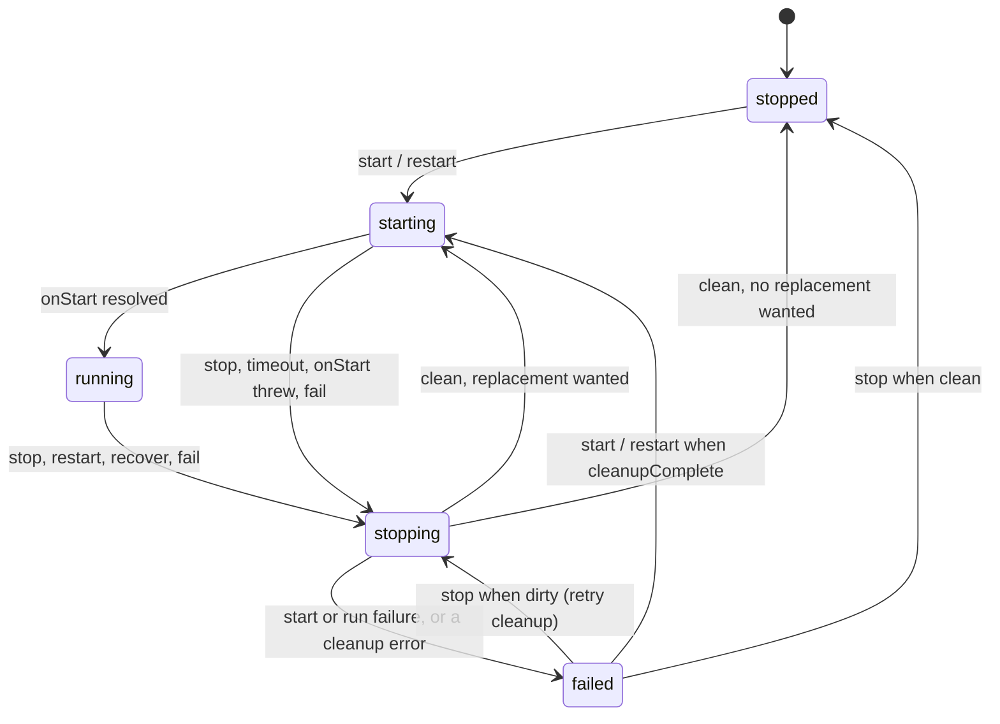

# `async-lifecycle-claude`

One reusable abstraction for **asynchronous lifecycle**: the `start` /
`running` / `stop` machinery that Wechaty, Puppet, Puppet providers,
PuppetService and IO all need, written and tested once.

This directory is the Claude implementation of the consolidated v1 design in
[wechaty/wechaty#2911], built on the contract discussed in
[wechaty/wechaty#2905]. It sits beside `src/async-lifecycle-copilot/` (from
#2912) for comparison. It is **not** exported from the package root or the
`exports` map until the API is frozen. Import it by path inside this repository.

[wechaty/wechaty#2911]: https://github.com/wechaty/wechaty/issues/2911
[wechaty/wechaty#2905]: https://github.com/wechaty/wechaty/issues/2905

## Why

Every long-lived Wechaty component re-implements the same error-prone steps:

- guard against a double start;
- abort a start that is still in flight;
- release resources in the right order;
- decide what a second `stop()` after a failed cleanup should do;
- tell "I asked to stop" apart from "it crashed";
- make `await bot.ready()` mean "ready for *this* run".

Getting those wrong leaks connections, double-fires handlers, or deadlocks.
This module puts the hard parts behind a small surface, so each component only
writes `onStart` (and maybe `onStop`).

## Design rules

These decide where every feature goes (v1 design §2):

1. **One engine, two shells.** `createLifecycle()` and `AsyncLifecycle`
   delegate to the same engine and add no behaviour.
2. **Authority lives in the scope.** Anything that acts on a run (`acquire`,
   `fail`, `recover`, `set`) is a method of that run's scope. A stale callback
   holds a dead scope, so it cannot touch a newer run.
3. **The engine holds only what needs private access.** A helper that can be
   written with the public scope is a companion (`listen`, `watchdog`).
4. **Mechanism in, policy out.** The engine checks whether a recovery is still
   authorized. It never decides whether or when to retry.
5. **Commit, then notify.** State is frozen and waiters are settled before any
   observer runs. Observer errors are isolated.
6. **Cleanup truth.** `stopped` means everything was released. A timeout, an
   abort or a discarded promise never counts as proof.

## Quick start

### Composition: `createLifecycle`

Use it when your class already extends something, as Wechaty and Puppet extend
an event emitter.

```ts
import { createLifecycle, listen } from './async-lifecycle-claude/mod.ts'

class Bot extends EventEmitter {

  readonly #lifecycle = createLifecycle({
    onStart: async scope => {
      listen(scope, this.puppet, 'ready',  () => scope.set(this.#ready))
      listen(scope, this.puppet, 'logout', () => scope.clear(this.#ready))
      await scope.start(this.puppet)          // a child lifecycle
    },
    onStateChange: state => {
      if (state.kind === 'running') { this.emit('start') }
    },
  }, { name: 'Bot', stopTimeoutMs: 10_000 })

  readonly #ready = this.#lifecycle.condition('ready')

  get state () { return this.#lifecycle.state }
  start (options?: LifecycleWaitOptions) { return this.#lifecycle.start(options) }
  stop  (options?: LifecycleWaitOptions) { return this.#lifecycle.stop(options) }
  ready (options?: LifecycleWaitOptions) { return this.#ready.wait(options) }

}
```

### Inheritance: `AsyncLifecycle`

Use it for a class with no other base.

```ts
import { AsyncLifecycle, type LifecycleScope, type LifecycleStop } from './async-lifecycle-claude/mod.ts'

class Io extends AsyncLifecycle {

  constructor (private readonly url: string) { super({ name: 'Io' }) }

  protected override async onStart (scope: LifecycleScope) {
    const ws = await scope.acquire(
      signal => openWebSocket(this.url, { signal }),
      ws => closeAndWait(ws),
      { interrupt: ws => ws.terminate() },   // unblocks tasks reading from it
    )
    scope.spawn(signal => keepAlive(ws, signal))
  }

  protected override async onStop (stop: LifecycleStop) {
    await sendGoodbye(stop.signal)           // resources are still live here
  }

}
```

## Caller API (Tier 1)

Both shells expose exactly this. Intent is accepted synchronously, before the
first `await`. An already-aborted `signal` rejects before any intent is
accepted. A `signal` only cancels *that caller's wait*; it never cancels shared
work.

| Member | Resolves when | Rejects when |
| --- | --- | --- |
| `state` | read-only frozen snapshot | — |
| `start()` | the attempt it joined commits `running` (at once if already running) | that attempt fails · a later `stop()`/`restart()` supersedes it (`LifecycleSupersededError`) · a dirty failure blocks it (`LifecycleUnsafeStateError`) · caller abort |
| `stop()` | the run it captured is released, even if a newer `start()` is queued | retirement reported an error · caller abort |
| `restart()` | the old run is released and the replacement commits `running` | either half fails · a later `stop()` supersedes it · dirty failure · caller abort |
| `whenState(predicate)` | the predicate matches the current or a later snapshot | caller abort · the predicate throws |
| `[Symbol.asyncDispose]()` | same as `stop()`; the instance can start again | same as `stop()` |

Equivalent concurrent calls share one attempt outcome; promise identity is not
guaranteed. Two `restart()` calls before the replacement starts share one
replacement. A failed attempt ends: nothing retries because "running" is still
wanted.

### State

```ts
type LifecycleState =
  | { kind: 'stopped' | 'starting' | 'running' | 'stopping', generation: number }
  | { kind: 'failed', generation: number, phase: 'start' | 'run' | 'stop',
      error: unknown, cleanupComplete: boolean, cleanupError?: unknown }
```

Every start attempt allocates a new `generation`, successful or not.



`failed` never implies "safely stopped". With `cleanupComplete: false`, owned
resources may still be live. Every `start()` / `restart()` is then refused with
`LifecycleUnsafeStateError` until a `stop()` retries the remaining cleanup.

## Implementer API (Tier 2)

### Hooks

| Hook | Contract |
| --- | --- |
| `onStart(scope)` | Acquire what the run needs through `scope`. Returning commits `running`. Throwing any value (falsy included) fails the attempt and unwinds the scope. |
| `onStop(stop)` | Optional graceful goodbye. Called **at most once per generation**, **only for a run that reached `running`**, before `scope.signal` aborts. `stop.reason` is `'stop' \| 'restart' \| 'recover' \| 'failure'`. `stop.signal` is the stop deadline, not the run's signal. A rejection is reported but never retried. |
| `onStateChange(state, previous)` | Optional observer, called after commit and after waiters are settled. Exceptions are isolated. Reentrant commands are safe. |

A partial start is rolled back by the ledger alone; `onStop` is not called.

### Options

| Option | Meaning |
| --- | --- |
| `name` | Diagnostics only. |
| `startTimeoutMs` | Expiry fails the attempt with `LifecycleTimeoutError('start')`, aborts the scope, and unwinds. |
| `stopTimeoutMs` | One deadline per retirement pass (`onStop`, joining `onStart`, the unwind, and any earlier work being joined). Expiry commits `failed { cleanupComplete: false }`. The unfinished work stays tracked, and the next `stop()` joins it. |
| `clock` | Timer source for the deadlines (inject one in tests). |

Both deadlines must be finite, non-negative numbers; anything else (`NaN`,
negative, `Infinity`) throws `RangeError` at construction. Omit an option for
no deadline.

### The scope (one per generation)

| Member | Contract |
| --- | --- |
| `generation`, `signal` | Identity of this run; `signal` aborts when it retires. |
| `acquire(create, release, { interrupt })` | Registers the release **before** `create` runs. A resource that resolves after retirement began is still released, and `acquire` rejects. A failed `create` releases nothing. `interrupt` runs synchronously after the abort, before anything is joined. |
| `use(resource)` | `Symbol.asyncDispose` or `Symbol.dispose`; anything else throws `TypeError`. |
| `defer(cleanup)` | A cleanup action. |
| `spawn(task)` | An owned background task, joined during retirement. A rejection other than its own abort fails the run; one during retirement is reported once as a cleanup error. |
| `start(child)` | Owns a child `Lifecycle` (either shell). See [Children](#children). |
| `set(condition)` / `clear(condition)` | Level-triggered, for this generation only. A condition declared on another lifecycle throws `TypeError`. |
| `fail(error)` | Ends this run with no replacement: `failed { phase: 'run' }` (or `'start'` before `running`). |
| `recover(reason?)` | See [Recovery](#recovery). |

Everything registered goes into **one ledger** that is released **newest first**
across all kinds. So cleanup registered after a child still sees that child
running.

#### Sealing and late registrations

The moment retirement is requested, the scope is **sealed**:

- `use` / `defer` release their argument immediately, keep it owned until that
  succeeds, and throw the retirement reason;
- `acquire`, `spawn` and `start(child)` refuse without running anything;
- `set`, `clear` and `fail` do nothing; `recover` returns `'superseded'`.

A late release that fails *after* its generation has fully retired becomes
**debt**:

- while idle, the state becomes `failed { cleanupComplete: false }`;
- while a newer run is live, that run's retirement retries the debt;
- either way, no clean `stopped` is published while debt remains.

### Retirement protocol

| Step | Reached `running` | Still `starting` |
| --- | --- | --- |
| 1. Seal the scope (synchronously, when retirement is requested) | yes | yes |
| 2. `onStop(stop)` with resources live | yes (once) | skipped |
| 3. Abort `scope.signal` | yes | yes (synchronously, when retirement is requested) |
| 4. Run `interrupt` callbacks, newest first | yes | yes |
| 5. Wait for `onStart` to settle | n/a | yes |
| 6. Unwind the ledger newest first, then older generations' debt; continue past errors | yes | yes |
| 7. Settle waiters, then commit | yes | yes |

Completion is read back from the ledger and the hook promises. A retry runs only
what is unfinished: a failed release is retried, a running one is joined, and
`onStop` is never replayed.

### Children

- The child must be `stopped` or cleanly `failed`, and not owned by another
  scope (the reservation is taken synchronously).
- Ownership is registered before `child.start()`, which receives the parent's
  `signal`, so a parent that stops mid-startup cancels the child.
- The child is stopped in ledger order. The reservation is released only after
  that stop **succeeds**, so a second parent cannot adopt it while the first
  may still retry.
- The parent's run fails when the child commits `failed`, or `stopped` without
  the parent asking. The child's error is the `cause`. A child that restarts or
  recovers itself (`stopping → starting`) is **not** escalated. Escalation
  therefore happens at the child's terminal snapshot, bounded by the child's own
  `stopTimeoutMs`.

### Conditions

```ts
const ready = controller.condition('ready')   // declare once per instance
scope.set(ready)                              // inside a run
await ready.wait()                            // caller side
```

- A wait binds to the generation that is `starting` or `running` and not
  retiring. Otherwise it binds to the **next** one, so
  `const p = ready.wait(); await start()` works.
- It resolves at once if the bound generation has the condition set.
- It rejects when that generation fails or retires first, when `stop()` is
  called before the wait is bound, or on caller abort.
- A result never crosses generations.

### Recovery

`scope.recover(reason)` retires this run and starts a replacement:
`running → stopping → starting → running`, with no `stopped` or `failed` in
between. It never counts as user intent.

- It is accepted only from the current generation while it is `running`.
  From a stale or retiring scope it returns `'superseded'`.
- Any user `start()` / `stop()` / `restart()` accepted before the replacement
  starts supersedes it (`'superseded'`), so a user `stop()` always wins
  (#2905 §3.3).
  Once the replacement is `starting`, a user `start()` joins that run's outcome
  instead, while `stop()` and `restart()` still supersede it.
- It resolves `'recovered'` when the replacement runs. It rejects when
  retirement reports an error or the replacement fails.
- Before `running` it behaves like `fail(reason)` and rejects with `reason`, so
  a first boot fails fast.
- The returned promise is pre-handled, so `void scope.recover()` is safe.
- From owned work (a `spawn()` task, a `listen()` handler), call
  `void scope.recover()` and do not await it. Recovery resolves only after this
  run retires, and retirement joins every owned task, so a task awaiting its own
  recovery waits on itself, exactly like a task awaiting `stop()`.

Back-off and retry budgets are policy. Wait at the top of the next `onStart`
under `scope.signal`, where `stop()` cancels the wait. Call `fail()` when the
budget is spent.

## Companions

Built only on the public scope:

- `listen(scope, target, event, listener)`: adds a listener to an
  EventEmitter-like object or an `EventTarget` and registers its removal.
  On a sealed scope nothing is added. Each call installs its own forwarding
  wrapper and removes only that, so a late `listen()` on a retired scope can
  never detach the same handler registered by a newer run (and
  `target.off(event, listener)` does not remove it; retirement does).
- `watchdog(scope, { timeoutMs, onTimeout?, clock? })`: returns `{ feed() }`.
  An expiry calls `scope.fail()` (default) or `scope.recover()` with
  `LifecycleTimeoutError('watchdog')`. The timer is cleared with the
  generation.

## Errors

| Error | When |
| --- | --- |
| `LifecycleSupersededError` | A newer intent replaced this request; the reason a retiring scope throws to late registrations. |
| `LifecycleTimeoutError` | A deadline expired (`phase: 'start' \| 'stop' \| 'watchdog'`). Never proof of cleanup. |
| `LifecycleUnsafeStateError` | A dirty failure blocks a new run, or a child is unsafe or already owned. |

Hook and cleanup failures surface as your own values. Several cleanup failures
become one native `AggregateError`.

## Diagnostics

One `node:diagnostics_channel` channel, `wechaty.async-lifecycle-claude`
(exported as `LIFECYCLE_DIAGNOSTICS_CHANNEL`). It publishes
`{ name, state, previous }` after every commit, and only when subscribed.

Snapshots carry `kind`, `generation`, and for `failed` also `phase` and
`cleanupComplete`, never `error` or `cleanupError` (#2883). Node reports a
throwing subscriber as `uncaughtException` on a later tick. It never changes a
lifecycle outcome.

## File layout

| File | Owns |
| --- | --- |
| `types.ts` | Every public shape (no runtime code) |
| `errors.ts` | The three error classes |
| `engine.ts` | Intent, attempts, the single reconciler, retirement and deadlines, debt, commit |
| `generation.ts` | One run's record and the scope built for it; child ownership |
| `ledger.ts` | The per-generation ownership ledger with per-entry status |
| `condition.ts` | Condition handles, wait binding and settlement |
| `diagnostics.ts` | Privacy-safe commit records |
| `clock.ts` | The default timer source |
| `create-lifecycle.ts`, `async-lifecycle.ts` | The two shells (delegation and the override guard only) |
| `companions/` | `listen`, `watchdog` |
| `testing.ts` | Test-only manual clock and microtask flush (not exported) |

## Tests

```sh
node --test src/async-lifecycle-claude
npm run test:unit:deno:file -- src/async-lifecycle-claude
```

`engine.test.ts` is the contract suite. It runs every trace through **both
shells** and covers:

- the #2905 §3.8 cases A–F, inverted;
- the v1 promise contracts and retirement protocol;
- one regression per review finding on PR #2913.

Deadlines use `ManualClock`. No test waits for real time.

## Known limits

- **Remote retirement:** a cancelled gRPC call does not prove the server
  stopped. Puppet Service needs its own session protocol (v1 design §9).
- **Pending late releases:** a late release on an already retired generation
  becomes debt only once it *fails*. One still in flight does not block a new
  run.
- **Deferred to integration work:** operation leases (`whenActive`), borrowed
  children, parent-driven restart of a failed child, and compatibility shims for
  `reset()` and the old `state` view (v1 design §9).
