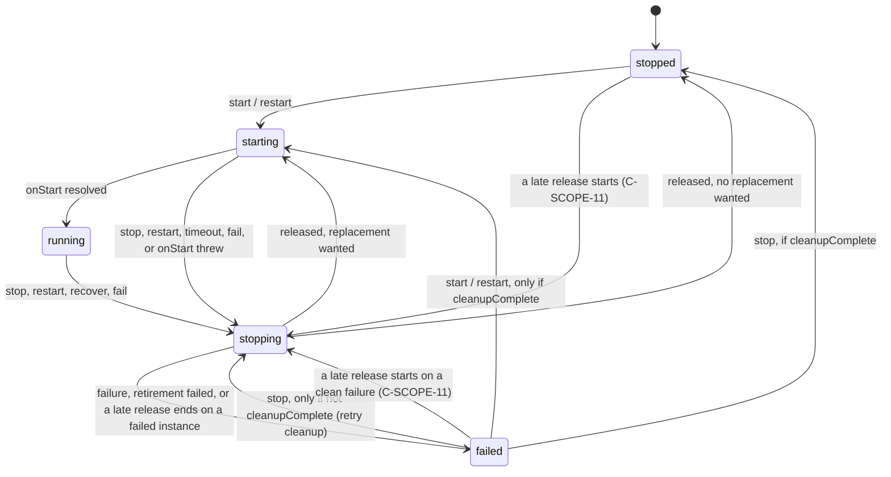

# AsyncLifecycle: the contract

One lifecycle module for every async layer of Wechaty: `Wechaty`, `Puppet`, `PuppetService`, `PuppetServer` and `Io`. It replaces `state-switch` and hand-written `start` / `stop` / `reset` (#2905).

**Status: release candidate, stage S1** of the convergence plan in [#2968](https://github.com/wechaty/wechaty/issues/2968). This directory holds the public types (`types.ts`), the errors (`errors.ts`) and this contract. The kernel lands in S4 ([#2972](https://github.com/wechaty/wechaty/issues/2972)). The API stays a release candidate until consumer validation in S5 ([#2973](https://github.com/wechaty/wechaty/issues/2973)). It is not exported from the package yet.

**How to read this file.** Each rule has an ID such as `C-CMD-04`. Tests cite these IDs, and so does the TSDoc in `types.ts`. To change a rule, change it here, give it a decision ID in #2968 §6, and update the tests that cite it. `D…` IDs refer to the decision log in #2968.

## 1. Model in one paragraph

Callers state **intent** (`start`, `stop`, `restart`). One **reconciler** per instance moves the state toward that intent, one step at a time; nothing else commits state. Every start attempt creates a new **generation** with its own **scope**. `onStart` acquires everything through that scope, and the scope records it in an ownership **ledger**. **Retirement** releases the ledger in a fixed order, and the state says truthfully whether everything was released. A callback from an old generation holds an old, sealed scope, so it cannot touch a newer one.

## 2. API at a glance

```ts
// Tier 1: callers
interface Lifecycle extends AsyncDisposable {
  readonly state: LifecycleState
  start (options?: LifecycleWaitOptions): Promise<void>
  stop (options?: LifecycleWaitOptions): Promise<void>
  restart (options?: LifecycleWaitOptions): Promise<void>
  whenState (predicate: (state: LifecycleState) => boolean, options?: LifecycleWaitOptions): Promise<LifecycleState>
  [Symbol.asyncDispose] (): Promise<void>
}

// Tier 2: implementers
interface LifecycleHooks {
  onStart (scope: LifecycleScope): void | Promise<void>
  onStop? (stop: LifecycleStop): void | Promise<void>            // { generation, reason, signal }
  onStateChange? (state: LifecycleState, previous: LifecycleState): void
}

interface LifecycleScope {
  readonly generation: number
  readonly signal: AbortSignal
  acquire<T> (create, release: (resource: T) => unknown, options?: { interrupt? }): Promise<T>
  use<T extends AsyncDisposable | Disposable> (resource: T): T
  defer (cleanup: () => unknown): void
  spawn (task: (signal: AbortSignal) => Promise<void>): void
  start (child: Lifecycle): Promise<void>
  set (condition): void
  clear (condition): void
  fail (error: unknown): void
  recover (reason?: unknown): Promise<'recovered' | 'superseded' | 'failed'>
}

// Entry points (create-lifecycle.ts, async-lifecycle.ts)
function createLifecycle (hooks: LifecycleHooks, options?: LifecycleOptions): LifecycleController
abstract class AsyncLifecycle implements Lifecycle { /* protected onStart, onStop, onStateChange, condition */ }
```

`types.ts` has the full signatures with TSDoc. `examples/` shows `Io`, a `Puppet` base and `Wechaty` written against them.

## 3. State



- **C-STATE-01** `state` is a frozen snapshot. Each transition publishes a new object; a snapshot never changes after it is published.
- **C-STATE-02** The initial state is `{ kind: 'stopped', generation: 0 }`.
- **C-STATE-03** Every start attempt allocates the next generation number, whether or not it succeeds. Generation numbers never decrease.
- **C-STATE-04** The only transitions are those in the diagram above.
- **C-STATE-05** `failed` carries `phase` (`'start'` before the generation committed `running`, `'run'` after, `'stop'` when retirement itself failed), `error` (the primary failure exactly as reported, falsy values included), `cleanupComplete`, and `cleanupError` when cleanup reported errors.
- **C-STATE-06** `failed { cleanupComplete: false }` means owned work may still be live. It blocks every new generation until a `stop()` finishes the cleanup.
- **C-STATE-07** `stopped` and `failed { cleanupComplete: true }` mean every obligation of every earlier generation was released. A deadline, an abort or a discarded promise never counts as released.

## 4. Commands

- **C-CMD-01** Commands accept intent synchronously, before their first `await`. If the caller's signal is already aborted on entry, the call rejects with `signal.reason` and changes nothing.
- **C-CMD-02** A caller's signal cancels only that caller's wait, never shared work or accepted intent.
- **C-CMD-03** Equivalent concurrent calls share one outcome, each with its own promise; promise identity is not guaranteed. In particular, concurrent `restart()` calls share one replacement and never create two.
- **C-CMD-04** `start()` while a generation is `running` and not retiring resolves at once and starts nothing.
- **C-CMD-05** `start()` while `starting` joins that attempt and never aborts it. This includes the replacement started by a recovery.
- **C-CMD-06** `start()` during retirement queues one replacement that starts only after the retirement completes. Two generations never overlap.
- **C-CMD-07** `stop()` supersedes every pending start, restart and recovery. Their callers reject with `LifecycleSupersededError`, and a pending `scope.recover()` resolves `'superseded'`.
- **C-CMD-08** `stop()` resolves when the generation it captured is released, even if a newer `start()` is already queued behind it.
- **C-CMD-09** `stop()` while `stopped` resolves at once. On a clean `failed` state it commits `stopped`, then resolves.
- **C-CMD-10** `stop()` on `failed { cleanupComplete: false }` retries only the obligations still unreleased. It commits `stopped` and resolves when they are all released; otherwise it stays dirty and rejects with the cleanup error. One exception: a `stop()` that joined unfinished work in which something failed reports that failure even if its retry released everything, and then commits a clean `failed { phase: 'stop' }` instead of `stopped` (C-TIME-03, D36).
- **C-CMD-11** `restart()` retires the current generation, if any, and resolves only when a new generation commits `running`. It is never a no-op while running. During `starting` it aborts that attempt, and the attempt's `start()` callers reject with `LifecycleSupersededError`; they do not join the replacement. A later `stop()` supersedes it.
- **C-CMD-12** `restart()` from `stopped` or a clean `failed` behaves like `start()`.
- **C-CMD-13** `start()` and `restart()` on `failed { cleanupComplete: false }` reject at once with `LifecycleUnsafeStateError` and change nothing. Only `stop()` can finish that cleanup (D27).
- **C-CMD-14** A failed attempt ends. Nothing retries because the intent is still "running". A new generation needs a new command or an accepted `scope.recover()`.
- **C-CMD-15** `[Symbol.asyncDispose]()` is `stop()`, and the instance can start again (D4).
- **C-CMD-16** `whenState(predicate)` resolves with the first snapshot, the current one included, for which `predicate` returns `true`; `failed` snapshots are passed to it like any other. It rejects only on caller abort, or with the error if `predicate` throws.
- **C-CMD-17** A failed start attempt rejects its callers when the failure is decided, at the first commit after it (normally `stopping`), not when its cleanup completes. A start timeout therefore reaches its callers at the deadline, even if the hook never settles. The outcome is fixed from that moment: a command accepted later, for example a `stop()` from an abort listener, does not turn it into `LifecycleSupersededError` (D35).

### Command by state

Adapted from the matrix in [#2905](https://github.com/wechaty/wechaty/issues/2905#issuecomment-6819763886). Where they differ, this table wins.

| State | `start()` | `stop()` | `restart()` |
| --- | --- | --- | --- |
| `stopped` | New generation | Resolve at once | Same as `start()` |
| `starting(G)` | Join `G`'s attempt | Abort `G`, supersede its waiters, retire `G` | Abort `G`, supersede its waiters, retire `G`, then start `G+1` |
| `running(G)` | Resolve at once | Retire `G` | Retire `G`, then start `G+1` |
| `stopping(G)`, no replacement queued | Queue `G+1` after `G` is released | Join the retirement of `G` | Queue `G+1` after `G` is released |
| `stopping(G)`, replacement queued | Join the queued `G+1` | Supersede the queued `G+1`; join the retirement of `G` | Join the queued `G+1` |
| `failed(G)`, clean | New generation | Commit `stopped`, resolve | Same as `start()` |
| `failed(G)`, dirty | Reject, `LifecycleUnsafeStateError` | Retry remaining cleanup | Reject, `LifecycleUnsafeStateError` (the #2905 matrix retried cleanup first; D27) |

## 5. Promise contracts

| Call | Resolves when | Rejects when |
| --- | --- | --- |
| `start()` | The attempt it joined commits `running` | The attempt fails (its error, as soon as the failure is decided, C-CMD-17) · a later `stop()`, or a `restart()` during `starting`, supersedes it · dirty state · caller abort |
| `stop()` | The generation it captured is released | Retirement reports errors (the cleanup error) · caller abort |
| `restart()` | The replacement commits `running` | Retirement or replacement fails · a later `stop()` supersedes it · dirty state · caller abort |
| `whenState()` | The predicate matches | Caller abort · the predicate throws |
| `condition.wait()` | The bound generation sets the condition | The bound generation retires first · `stop()` before the wait is bound · caller abort |
| `scope.acquire()` | `create` resolved while the scope is live | `create` rejects (its error) · retirement began (the retirement reason) |
| `scope.start(child)` | The child commits `running` | The child's start fails · the child is not idle and clean, or already owned · this scope is sealed · this scope's signal aborts while the child is starting (C-CHILD-03) |
| `scope.recover()` | Always resolves (D10) | Never |

## 6. Scope

- **C-SCOPE-01** Each generation has one scope, frozen. Its `generation` and `signal` belong to that generation only.
- **C-SCOPE-02** When the generation starts retiring, its scope is **sealed**. Then `use` and `defer` release their argument at once (tracked until that succeeds) and throw the retirement reason; `acquire` and `start` reject and `spawn` throws, with the retirement reason, without running anything; `set`, `clear` and `fail` do nothing; `recover` resolves `'superseded'`. The retirement reason is the generation's failure if it failed, otherwise a `LifecycleSupersededError`.
- **C-SCOPE-03** Obligations are released in the retirement order of C-RET-01.
- **C-SCOPE-04** `acquire` registers the release before `create` runs. If `create` resolves after retirement began, the resource is released and `acquire` rejects with the retirement reason at once, without waiting for that release to finish, so a hook awaiting it can return (D41). If `create` rejects, `acquire` rejects with that error and leaves no obligation behind, so a retry loop does not grow the ledger.
- **C-SCOPE-05** An `acquire` `interrupt` runs once, synchronously, in retirement step 4. For a resource still being created, it runs as soon as the resource exists, and always before that resource's release. A synchronous throw is a cleanup error. Every interrupt is called without waiting for another. A promise-like it returns is tracked like a spawned task: it is joined in step 6 under the stop deadline, its rejection is a cleanup error, and its resource is not released before it settles. Any other returned value is ignored (D38).
- **C-SCOPE-06** `use` takes `Symbol.asyncDispose` when present, otherwise `Symbol.dispose`, and throws `TypeError` for anything else.
- **C-SCOPE-07** A `spawn` task receives `scope.signal`. A rejection with `signal.reason` is its own cancellation. Any other rejection fails the generation while it is live, or becomes a cleanup error while it is retiring.
- **C-SCOPE-08** Registering the same function twice creates two obligations.
- **C-SCOPE-09** A release that fails stays owned and is retried by the next `stop()`. A release that is still running is joined, never started twice.
- **C-SCOPE-10** `defer` cleanups and `acquire` releases may return any value. A returned promise-like is awaited and its rejection is a cleanup error; any other value is ignored. A synchronous throw is a cleanup error too, handled exactly like a rejection: it never escapes as an uncaught exception, and it never stops later obligations from being released. Cleanups are therefore typed `() => unknown`, so common one-liners such as `() => emitter.off(event, listener)` type-check even though `off()` returns the emitter (D29).
- **C-SCOPE-11** A late release, one registered on a scope whose generation has already been released (C-SCOPE-02), is an obligation of the instance until it succeeds (D31). A late release that fails is cleanup **debt** of the instance:
  - While it runs, a generation that is `starting` does not commit `running` until the late release finishes; the wait counts against its start deadline (C-TIME-02). If the late release fails, that start fails with the release error and the instance ends `failed { cleanupComplete: false }`.
  - While it runs on an idle instance (`stopped`, or a clean `failed`), the state is `stopping`, and commands follow the `stopping` row of the command table: a `stop()` or `restart()` joins it as a retirement pass under its own stop deadline, which starts at acceptance (C-TIME-03), and a `start()` queues behind it (C-CMD-06). When it succeeds, the instance returns to the idle state it left: `stopped`, or the same clean `failed` (its generation, `phase` and `error`), unless a command accepted meanwhile decides otherwise. Only `stop()` turns a clean `failed` into `stopped` (C-CMD-09). When it fails, the state is `failed { cleanupComplete: false }` with the release error as `cleanupError`: from `stopped` with `phase: 'stop'` and the release error as `error`; from a clean `failed`, that failure's `phase` and `error` are kept, as the first failure wins.
  - If it fails while a generation is `running`, that generation keeps running: a live run is not taken down by an earlier generation's cleanup, and `running` makes no claim about it. Its retirement retries the debt with its own releases (C-SCOPE-09) and reports the error if the retry fails too (C-RET-06), so `stopped` and a new generation still wait until the debt is cleared. The failure produces no commit, so no observer sees it; S4 decides how diagnostics report it.
  - If it fails while a generation is retiring, that retirement reports it as a cleanup error.

## 7. Retirement

- **C-RET-01** A generation retires in this order (D9):
  1. **Seal** the scope (C-SCOPE-02).
  2. **`onStop`**, only if the generation reached `running`. It runs with its resources live and `scope.signal` not yet aborted, under the stop-deadline signal.
  3. **Abort** `scope.signal`.
  4. **Interrupt**: run every `acquire` `interrupt`, newest first, synchronously, without waiting for any (C-SCOPE-05).
  5. **Wait for `onStart`** to settle, if it is still running.
  6. **Join every spawned task**, and every promise returned by an interrupt.
  7. **Release** resources and deferred cleanups and stop children, newest first, continuing past errors.
  8. **Commit**: `stopped`, `starting` for a queued replacement, or `failed` with the truth about `cleanupComplete`.

  Tasks are joined before anything is released, because tasks use resources: a task registered before a resource may still depend on it. A task must therefore return once its signal aborts or its resource is interrupted. A task that does neither holds retirement until the stop deadline.
- **C-RET-02** `onStop` runs at most once per generation and is never retried. Its rejection is a cleanup error (D8).
- **C-RET-03** A generation that never reached `running` is rolled back by its ledger alone; `onStop` is not called (D8).
- **C-RET-04** One cleanup error is reported as itself; several are reported as an `AggregateError`.
- **C-RET-05** Concurrent `stop()` calls, and `Symbol.asyncDispose`, share one retirement pass per generation.
- **C-RET-06** A replacement starts only after the previous generation was released. If that retirement reports errors, the queued replacement does not start: its callers reject with the cleanup error, and the state is `failed { phase: 'stop' }`.
- **C-RET-07** If a generation is already retiring when its `onStart` would be called, for example after a `stop()` from the `starting` observer, `onStart` is not called. Calling it with an aborted scope would make an abort-driven hook miss the abort (D34).

## 8. Deadlines

- **C-TIME-01** `startTimeoutMs` and `stopTimeoutMs` must be finite, greater than 0 and at most 2³¹−1. Anything else throws `RangeError` when the instance is created. Omitted means no deadline (D11).
- **C-TIME-02** The start deadline runs from the commit of `starting` until the attempt can commit `running`: until `onStart` settles and every late release the generation waits for has finished (C-SCOPE-11). On expiry the attempt fails with `LifecycleTimeoutError` (`phase: 'start'`) and the generation retires. The hook stays tracked until it settles.
- **C-TIME-03** The stop deadline covers one whole retirement pass: `onStop`, waiting for `onStart`, joining tasks, and releases. It starts when the retirement is requested, that is when the command is accepted, before any abort listener runs. On expiry the state becomes `failed { phase: 'stop', cleanupComplete: false }` with a `LifecycleTimeoutError`. Unfinished work stays tracked. The next `stop()` joins it, and within its own deadline retries, once, every obligation that failed, including one that failed in the work it joined (D36). Errors from the joined work are still reported, because the `stop()` that timed out reported only the timeout: the joining `stop()` rejects with them, and the state is `failed { phase: 'stop' }`, whose `cleanupComplete` says whether the retry released everything. A caller that only wants the instance stopped calls `stop()` again. The two deadlines start at different points on purpose: the stop deadline at acceptance, so that `stop()` settles within `stopTimeoutMs` of the call even if an abort listener blocks; the start deadline at the commit of `starting` (C-TIME-02), so that a `start()` queued behind a slow retirement does not time out before its `onStart` runs.
- **C-TIME-04** All deadlines use the injected `LifecycleClock`; the default uses the global timers (D12).
- **C-TIME-05** A deadline is judged by the clock. If `clock.now()` shows that a deadline has passed when an outcome would be committed, the outcome is a timeout, even if the deadline's timer has not fired, for example because a hook blocked the thread. The timer only wakes the reconciler (D30).

## 9. Failure and recovery

- **C-REC-01** `scope.fail(error)` retires the generation with no replacement and ends `failed` (`phase: 'run'` if it reached `running`, otherwise `'start'`). The first failure wins, and its value is kept as given.
- **C-REC-02** `scope.recover(reason)` from a running generation retires it (`onStop` reason `'recover'`) and starts a replacement without counting as user intent: `running → stopping → starting → running`, with no `stopped` or `failed` in between.
- **C-REC-03** `scope.recover()` never rejects (D10). It resolves `'recovered'` when the replacement commits `running`. It resolves `'superseded'` when called from a retired or retiring scope, or when a `stop()` or `restart()` is accepted before the replacement commits `running`. That includes a replacement still in `starting`, for example one retrying its connection under C-REC-06, which the user cancels; that is never reported as `'failed'`. A `start()` accepted meanwhile does not supersede the recovery; it joins the replacement (C-CMD-05). It resolves `'failed'` when called before `running` (it then acts like `fail(reason)`, so a first boot fails fast), or when the retirement or the replacement fails.
- **C-REC-04** Recovery authority is checked again after the old generation is released, so a `stop()` or `restart()` accepted in the meantime always wins.
- **C-REC-05** The retirement started by `recover()` does not wait for the spawned task that itself called that `recover()` and is awaiting it (D19). Only that task is exempt, identified by the call being made from its own execution. Another task that awaits the same result indirectly, for example through a shared promise, is joined as usual, so it must return once `scope.signal` aborts. The exempt task must return promptly once the result arrives and must not use the retired generation's resources. How the kernel identifies the calling task is decided in S4 (D22): `AsyncLocalStorage`, which the Copilot comparison implementation already uses under both Node.js and Deno, or an explicit per-task handle.
- **C-REC-06** The module has no retry policy: no backoff, no budget, no automatic restart (D7). Implementers write policy in their hooks. The usual pattern is to retry inside `onStart` under `scope.signal`, so the state stays `starting` while offline and `stop()` cancels the wait; see `examples/io.example.ts`. A recovery whose replacement fails ends `failed`, and an owning parent then fails too (C-CHILD-05).

## 10. Children

- **C-CHILD-01** `scope.start(child)` needs only the `Lifecycle` interface. The child must be `stopped` or cleanly `failed` and not owned by another scope. Otherwise it rejects with `LifecycleUnsafeStateError` and does not touch the child. Whether a child can be claimed is decided by its public `state` alone, which is all a child from another installed copy of the module exposes. A child whose `start()` was accepted but has not committed yet still reads `stopped`, so it can be claimed, and the claim joins that start (D33).
- **C-CHILD-02** Ownership is recorded before `child.start()` is called, and released only after this scope's `child.stop()` succeeds. Until then no other scope can own the child.
- **C-CHILD-03** `scope.start(child)` waits for the child with the parent's `scope.signal` as its caller signal. When the parent retires while the child is still starting, the wait rejects with the abort reason at retirement step 3, so the parent's `onStart` can settle (step 5). Ownership is kept, and the child is stopped in step 7. Without this, a parent waiting on a child that keeps retrying, such as an offline `Io`, would hold its own retirement until the stop deadline.
- **C-CHILD-04** Children start in the order the hook starts them, and stop in retirement step 7, newest first, together with resources.
- **C-CHILD-05** When a child commits `failed`, or commits `stopped` without the parent asking, the parent generation fails with `LifecycleChildFailureError`; its `cause` is the child's error, or `undefined` for an unrequested stop. A child that restarts or recovers itself (`stopping → starting`) is not escalated. Escalation applies only while the parent generation is live: once it is retiring, a child that stops or fails unasked is not escalated, and step 7 stops it as usual. A clean `failed` child then commits `stopped` (C-CMD-09), a dirty one has its cleanup retried (C-CMD-10), and a failure to stop it is a cleanup error of the parent (D39).
- **C-CHILD-06** When the child's start fails, `scope.start()` rejects with that error, and the module creates no unhandled rejection.
- **C-CHILD-07** If an owned child restarts itself while its parent is stopping it, so that the child is not `stopped` when the parent's stop of it settles, the parent's retirement reports a `LifecycleUnsafeStateError` cleanup error. The parent ends `failed { cleanupComplete: false }`, keeps owning the child, and its next `stop()` stops the child again (D32).

## 11. Conditions

- **C-COND-01** Conditions are declared per instance by name; the same name returns the same condition. `set` and `clear` with a condition declared on another instance throw `TypeError`.
- **C-COND-02** A wait binds to the generation that is `starting` or `running` and not retiring. Otherwise it binds to the next generation to start, so a wait created before `start()` works.
- **C-COND-03** A wait resolves when its bound generation sets the condition, or at once if it already has.
- **C-COND-04** A wait rejects with `LifecycleSupersededError` when its bound generation retires first (the generation's failure, if any, is the `cause`), or when `stop()` is accepted before the wait is bound to a generation. It rejects with the caller's abort reason on abort (D28).
- **C-COND-05** Results never cross generations. A `set` from a stale scope does nothing, and a new generation starts with every condition clear.
- **C-COND-06** `isSet` is `true` only while the current live generation has the condition set (D23).

Usage notes, not rules:
- A wait created before `start()` rejects if that start fails, so give it a handler at once, for example `await Promise.all([ bot.ready(), bot.start() ])`. Awaiting `start()` first leaves the wait unhandled when `start()` throws.
- To expose a child's condition, delegate to the child (`ready () { return this.puppet.ready() }`) rather than mirroring it into a condition of your own. A mirror would also have to be cleared whenever the child's generation retires, which no child event reports.
- A delegated wait is bound to the child, so on its own it does not reject when the parent stops or fails before it ever owned the child. Pass the child a signal that the parent aborts when it accepts `stop()` or fails, as `examples/wechaty.example.ts` does.

## 12. Observers and diagnostics

- **C-OBS-01** Each commit runs in this order: freeze the snapshot; settle the outcomes of attempts, stops and condition waits; resolve `whenState` waiters; publish diagnostics; call `onStateChange`.
- **C-OBS-02** A throwing `onStateChange` or diagnostics subscriber is isolated and never changes an outcome. A throwing `whenState` predicate rejects only its own wait.
- **C-OBS-03** Observers may call commands. There is only ever one reconciler per instance, and a command from an observer is accepted like any other.
- **C-OBS-04** After each commit, and only when the channel has subscribers, a `LifecycleDiagnosticRecord` is published on the `node:diagnostics_channel` channel `wechaty.async-lifecycle.state` (D23). A record holds the `name` option and the structural fields of the previous and current snapshots (`kind`, `generation`, and for `failed`, `phase` and `cleanupComplete`). It never holds errors or application data.

## 13. Entry points

- **C-SHELL-01** `createLifecycle(hooks, options)` and `abstract class AsyncLifecycle` share one engine and behave identically; the entry points add no behavior.
- **C-SHELL-02** The caller-API members of `AsyncLifecycle` (`state`, `start`, `stop`, `restart`, `whenState`, `Symbol.asyncDispose`) cannot be overridden; either kind of override fails `new`. An override declared as a **method** on a subclass is detected by the base constructor, which throws `LifecycleOverrideError`. An override declared as a **class field** is defined only after the base constructor returns, so the base cannot detect it. Instead, the base constructor installs these members as own, non-writable, non-configurable properties: defining the field then throws a native `TypeError`, and assigning to one fails.
- **C-SHELL-03** `createLifecycle` throws `TypeError` when `hooks.onStart` is not a function, or `onStop` / `onStateChange` is present but not a function.
- **C-SHELL-04** The `name` option is a diagnostics label. It is published (C-OBS-04), so it must not contain secrets.

Choosing an entry point: use `AsyncLifecycle` for a class with no other base (`Io`). Use `createLifecycle` for a class that keeps its base, such as an EventEmitter (`Puppet`, `Wechaty`), or whose subclasses already own the names `onStart` / `onStop` (Puppet providers).

## 14. Errors

Branch on `code`, or use `isLifecycleError(value, code?)`. Don't rely on `instanceof`: with two installed copies of the module, an error from one copy is not an instance of the other copy's classes (D13).

| Class | `code` | When |
| --- | --- | --- |
| `LifecycleError` | (base) | Base of all of the below |
| `LifecycleSupersededError` | `ERR_LIFECYCLE_SUPERSEDED` | A newer command won (C-CMD-07, C-COND-04), or the retirement reason of a sealed scope |
| `LifecycleTimeoutError` | `ERR_LIFECYCLE_TIMEOUT` | A start or stop deadline expired; has `phase` and `timeoutMs` |
| `LifecycleUnsafeStateError` | `ERR_LIFECYCLE_UNSAFE_STATE` | A command refused on a dirty state, or an unusable child (C-CMD-13, C-CHILD-01) |
| `LifecycleChildFailureError` | `ERR_LIFECYCLE_CHILD_FAILURE` | An owned child failed or stopped unasked; `cause` is its error (C-CHILD-05) |
| `LifecycleOverrideError` | `ERR_LIFECYCLE_OVERRIDE` | A subclass method overrode a caller-API member; has `member`. A class-field override fails with a native `TypeError` instead (C-SHELL-02). |

The module also passes through, without wrapping: hook errors as reported (falsy values included), `AggregateError` for several cleanup errors (C-RET-04), `RangeError` for invalid options (C-TIME-01), and `TypeError` for misuse (C-SCOPE-06, C-COND-01, C-SHELL-02 for class-field overrides, C-SHELL-03).

## 15. Companions (planned, S4)

Helpers built only on the public scope; they need nothing private (D17). Their exact signatures land with their implementation in S4 (D26):

- `listen(scope, target, event, listener)`: add a listener to an EventEmitter-like or EventTarget object and register its removal. It replaces the repeated `on` plus `defer(off)` pairs in `examples/`.
- `watchdog(scope, { timeoutMs, onTimeout })`: a timer bound to the scope; if it is not fed in time, it calls `scope.recover()` or `scope.fail()`.

## 16. Decisions in this document

The full log, with sources and history, is #2968 §6. This file follows these:

| ID | Decision |
| --- | --- |
| D1 | One engine, two entry points; no mixin |
| D2 | Caller API: `state`, `start`, `stop`, `restart`, `whenState`, `Symbol.asyncDispose` |
| D3 | `state` is a frozen five-kind union with cleanup truth |
| D4 | `Symbol.asyncDispose` equals `stop()`; the instance is reusable |
| D5 | Readiness is named conditions; there is no `ready()` in the module |
| D6 | `acquire` records ownership before `create`; no `adopt` |
| D7 | Mechanism in the kernel, retry policy outside |
| D8 | `onStop` only for a run that reached `running` |
| D9 | Retirement order of C-RET-01: tasks are joined before anything is released |
| D10 | `scope.recover()` never rejects; it resolves `'recovered' \| 'superseded' \| 'failed'` |
| D11 | Timeouts: finite, > 0, ≤ 2³¹−1, else `RangeError` |
| D12 | `LifecycleClock` is `{ now, setTimeout, clearTimeout }` |
| D13 | Errors share `LifecycleError` with a stable `ERR_LIFECYCLE_*` `code`; `isLifecycleError()` checks by shape |
| D17 | `listen` and `watchdog` are companions, not scope members |
| D18 | `onStop` receives `{ generation, reason, signal }` |
| D19 | Recovery does not deadlock on the task that requested it |
| D23 | `condition.isSet` exists; options type is `LifecycleWaitOptions`; diagnostics channel is `wechaty.async-lifecycle.state` |
| D25 | `scope.start(child)` returns `Promise<void>` and takes a child, not a factory |
| D26 | Companion signatures land with their implementation (S4), not in S1 |
| D27 | `restart()` on a dirty `failed` rejects at once, as `start()` does; only `stop()` finishes cleanup |
| D28 | A condition wait whose generation retires rejects with `LifecycleSupersededError`, with the failure as `cause` |
| D29 | `defer` cleanups and `acquire` releases are typed to return `unknown`; promise-likes are awaited, other values ignored |
| D30 | A deadline is judged by the clock when an outcome would be committed (C-TIME-05) |
| D31 | A late release is an obligation of the instance: new generations wait for it, an idle instance shows `stopping` and then returns to the idle state it left, a failure leaves cleanup debt that a running generation carries until its retirement retries it (C-SCOPE-11) |
| D32 | A child that restarts itself during its parent's stop leaves the parent with cleanup debt; the parent keeps it (C-CHILD-07) |
| D33 | A child can be claimed based on its public state alone (C-CHILD-01) |
| D34 | `onStart` is not called for a generation that is already retiring (C-RET-07) |
| D35 | A failed start rejects when the failure is decided, not after cleanup (C-CMD-17) |
| D36 | A `stop()` joining unfinished work retries, once, what failed in it, within its own deadline (C-TIME-03) |
| D37 | A `start()` during a recovery joins its replacement; only `stop()` and `restart()` supersede a recovery (C-REC-03) |
| D38 | Interrupts are all called at once; a promise one returns is joined like a task, and its rejection is a cleanup error (C-SCOPE-05) |
| D39 | A child that stops or fails unasked while its parent is retiring is not escalated; the parent stops it as usual (C-CHILD-05) |
| D41 | A late acquisition's `acquire()` rejects at once, without waiting for its release (C-SCOPE-04) |

## 17. Not in this module

- **Retry, backoff, budgets and supervision policy** (D7). Write them in hooks, or later as companions.
- **What happens to an in-flight `messageSend` during `stop()`**, legacy `reset()` and `state.active()` shims, and the legacy event mapping. These are decided in S5 (D24); `examples/` shows the event mapping done by the owner.
- **Proof that a remote peer stopped.** Cancelling a gRPC call does not prove the server released anything; PuppetService needs its own session protocol.

## 18. Internal components

The kernel follows the [v1 design §5](https://github.com/wechaty/wechaty/issues/2911#issuecomment-6873515089). It started from Claude's comparison implementation (D40) and is changed in S4 (#2972) only through the contract suite. These boundaries are part of the design: keep them when changing the code.

| Component | File | Owns |
| --- | --- | --- |
| Types | `types.ts` | The public contract. No runtime code |
| Errors | `errors.ts` | `LifecycleError` and its subclasses, their `code`s, `isLifecycleError` |
| Engine | `engine.ts` | Intent and attempts, caller waits, generation allocation, the single reconciler, retirement and its deadlines, cleanup debt, late releases (C-SCOPE-11), and the commit that publishes a snapshot. Every rule of §3 to §12 is enforced here |
| Generation scope | `generation.ts` | One run: its `AbortController`, its ledger, its seal, and the scope object its hooks receive. It never commits state or settles a caller; it asks the engine through a narrow host interface |
| Ledger | `ledger.ts` | A generation's obligations with per-entry status, released newest first, a failed entry retried, a running one joined. It knows nothing about state |
| Conditions | `condition.ts` | Declared conditions, waits bound to a generation, and each live generation's set flags |
| Clock | `clock.ts` | The default `LifecycleClock`: global timers, and `performance.now()` |
| Diagnostics | `diagnostics.ts` | Publishing on `wechaty.async-lifecycle.state`, after commit and only when subscribed |
| Entry points | `create-lifecycle.ts`, `async-lifecycle.ts` | Delegation to the engine; the class adds only the override guard (C-SHELL-02) |
| Companions | `companions/` | `listen`, `watchdog` (planned, §15) |
| Module | `mod.ts` | Public exports |

Rules the engine keeps, from its own header:
- **Commands only record intent.** `start`, `stop`, `restart`, `fail` and `recover` change intent synchronously. They never commit state and never run hooks.
- **One writer.** Only the reconciler commits snapshots, one step at a time, so a reentrant command only changes what the next step is.
- **One retirement path.** Stop, restart, recover, failure and cleanup retry all go through the same retirement, which settles caller waits before observers see the new snapshot.
- **Cleanup truth.** Completion is read back from the ledgers and the hook promises, never inferred from "no error" or from a deadline.
